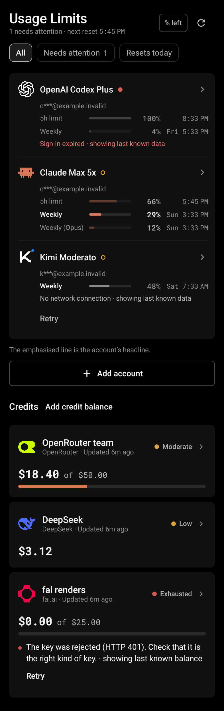
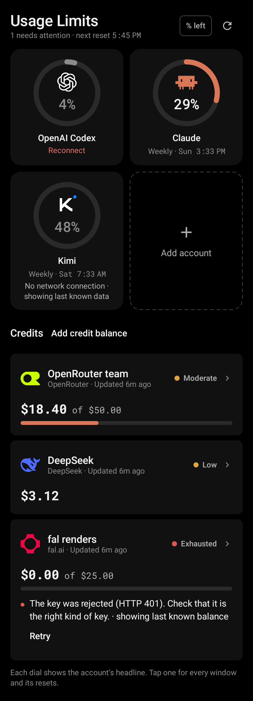

<p align="center"></p>

<h1 align="center">Usage Limits Mobile</h1>

<p align="center">Usage readings and reset times for supported AI subscriptions, plus prepaid API balances, in the app and on home-screen widgets.</p>

<p align="center">
<a href="#build-it-yourself"></a> <a href="#build-it-yourself"></a> <a href="#build-it-yourself"></a>
</p>

<p align="center"><a href="#what-the-app-does">What it does</a> · <a href="#supported-services">Services</a> · <a href="#prepaid-credits">Credits</a> · <a href="#widgets">Widgets</a> · <a href="#your-data">Your data</a> · <a href="#build-it-yourself">Build</a></p>

> **0.5.0 release candidate, not a published release.** These instructions describe `release/0.5.0`, not `main` or a released APK. The Android and iOS software changes are integrated; full CI for this combined candidate remains pending. Earlier green Android runs do not verify the newer changes. Physical-device checks remain open on both platforms. See [candidate evidence and remaining gates](docs/release.md#release-050-checkpoint).
>
> Build from source or download the debug APK from an Android run under **Actions**. Match the artifact to its commit.

<p align="center"></p>

Android List and Dials, rendered from native Compose views by `RedesignCaptureTest` at `a0857ee7d8b70a46a733c364bc36f636abb2414f` (Robolectric API 34, synthetic accounts). These tall scrolling-view captures are not emulator or phone screenshots. [Capture provenance and before/after selection](docs/release.md#selected-android-captures).

## What the app does

Connect a supported subscription to read its usage windows and reset times. Both native apps have three destinations: **Overview**, **Resets** and **Settings**. Account management starts in Overview; there is no separate Accounts tab.

| Destination | What it shows |
| :--- | :--- |
| Overview | Usage accounts in List or Dials, plus the optional Credits block |
| Resets | Recorded upcoming resets, grouped by day |
| Settings | Appearance, display mode, Overview layout, icons, sync and notifications |

The app also supports:

- **Several accounts per service.** Each identity keeps its own usage windows.
- **Retained readings.** A failed refresh keeps the previous readings and their age. A passed reset is marked **Reset due**, not treated as a fresh allowance.
- **In German too.** The app and its widgets follow the device language and come in English
  and German. Names the services report, such as model names, are shown as they arrive.
- **Status icons.** Pin up to three accounts and see each one's figure next to the clock on
  Android, or on the Lock Screen on iPhone. Off until you turn it on. See
  [Status icons](docs/status-icons.md).
- **No model calls.** The app only asks each service for your usage. It never sends a prompt,
  so checking your limits never costs you any of them.

<a id="android-overview-and-settings"></a>

## Overview and Settings

Choose **Settings → Overview → Layout** for **List** or **Dials**. List shows every usage window and emphasises the account's **headline**. Dials shows one headline ring per account, without filters. Tap either layout's account to open the same detail screen, including every window, refresh, reconnect, alerts and removal. **Show subscription tier** affects List titles, not Dial names. Reset stamps stay visible; there is no Show renewal time switch.

The headline follows [ADR 0002](docs/adr/0002-one-account-headline-per-platform.md): prefer windows not reset due, then global windows, then exhaustion and the lowest known percentage left. An account's status mark can reflect a worse model-specific window without making it the headline.

Overview sorts automatically: expired sign-ins first, then the headline's unrounded percentage left, lowest first. Provider-declared exhaustion ranks as zero; unknown figures come last within each sign-in group. Ties use account-added time, then ID. **Used** does not change this order. There is no manual reorder; pins, Provider-scoped widgets and Custom selections retain their separate [order contracts](docs/adr/0004-automatic-overview-order-and-stored-order.md).

In List, choose one filter:

- **All** shows every usage account.
- **Needs attention** shows expired sign-ins only, not low or exhausted allowance, stale readings or ordinary refresh failures.
- **Resets today** shows accounts with a recorded reset after now and before the next local day starts, not the next 24 hours.

Switching to another primary destination or to Dials returns the filter to All; opening an account detail and returning keeps it. The header counts expired sign-ins across all accounts. “All accounts have room” appears only when every headline is current, known, non-exhausted and above 20% left. Its next-reset time comes from connected accounts, independently of the filter.

**Settings → Display → Show percentages as** and the Overview percentage chip write the same **Left/Used** choice. Figures, bar lengths and ring arcs follow it; severity, account order, mood and alert thresholds still follow what is left. [Percentage details](docs/widgets.md#percentages-left-or-used) cover unknown and stale readings. The previews show the chosen display mode and layout without changing real accounts. For prepaid controls and hidden balances on both platforms, see [Credit balances](docs/credits.md#credits-in-overview).

### App appearance and fonts

Under **Settings → Appearance**, both apps offer **Warm dark**, **Pure black** (default), **Cool graphite** and **Light paper**. Android text choices start with system **Roboto**; iOS starts with Apple's **System** text. Both also offer **Roboto Flex**, **IBM Plex Sans** and **Figtree**. Choose **Roboto Mono** (default), **JetBrains Mono** or **IBM Plex Mono** independently for percentages, times and amounts. The preview reacts immediately; no restart is required.

Open **Font licences** in that section for the six bundled families' offline notices. Their pinned sources, versions, checksums and full licences are in the [canonical font manifest](third_party/fonts/manifest.json) and [font notes](third_party/fonts/README.md). These choices affect the app, not placed widgets or their configuration previews ([ADR 0005](docs/adr/0005-app-and-widget-appearance.md)). iOS bundles the canonical font files and licences in the app only, not its widget extension. The first app-controlled interface waits for saved preferences; iOS shows a neutral root while loading them. This is implemented behavior, not physical cold-launch proof.

On a German device, use **Einstellungen → Übersicht → Layout → Liste/Ringe**, **Anzeige → Prozente anzeigen als**, or **Erscheinungsbild** for **Textschrift**, **Ziffernschrift** and **Schriftlizenzen**. The List filters are **Alle**, **Braucht Aufmerksamkeit** and **Resets heute**.

### Claude Code mood and Hooray

Under **Settings → Provider icons → Claude**, the **Claude Code · Color** and **Claude Code · Monochrome** choices use the account's headline for their figure. Other artwork stays static. Mood uses raw percentage left, never the rounded or Used figure:

| Raw headline percentage left | Steady mood |
| :--- | :--- |
| 0, or provider-declared exhaustion even with a positive or missing figure | Asleep |
| Above 0 through 20 | Tired |
| Above 20 through 50 | Working |
| Above 50 through 90 | Idle |
| Above 90 | Dancing |
| No known figure, without declared exhaustion | Idle |

A stale reading or expired sign-in can retain its last mood; passing a reset time is not evidence of a refill. **Animate Claude Code icon** is on by default for the two eligible choices. Turn it off for still poses; Android's **Remove animations** and iOS **Reduce Motion** also stop movement. The figure stops outside its visible, active screen. In Resets it always uses Hooray, including its still pose when motion is off.

Both apps remember a reset only when a new measured reading confirms the same account/window's dated rollover: the previous reading preceded its advertised reset, the new reading reaches or passes it, and the next reset has advanced into the future. An increase in allowance, clock crossing, first reading or failed refresh does not qualify.

At the next qualifying main-app opening, the app claims the mark before refreshing. After the loaded, active screen's first ready placement, each qualifying account with a visible eligible figure gets one shared four-second Hooray presentation. Motion off uses its still pose for the same time. Android counts a process foreground transition with the main activity started; recreation, resume alone and widget configuration do not count. iOS counts initial activation and a return from background to active, not an inactive-only interruption. Returning from browser sign-in counts only when the platform's opening rule applies.

An interrupted or unseen opportunity does not replay later. Placed Usage Bars, Account Rings and Mini Rings use each account's steady mood, never Hooray; configuration keeps static catalog artwork. Both implementations use the same dated-reset vectors. See [candidate proof and remaining CI/device gates](docs/release.md#release-050-checkpoint). Real foreground transitions, first placement and animation pacing still need device checks.

## Supported services

| Service | What you see | How you connect |
| :--- | :--- | :--- |
| **OpenAI Codex** | Five-hour and weekly limits, plan limits, reset credits | Sign in through your browser (or a device code) |
| **Claude** | Five-hour, weekly and per-model limits | Sign in through your browser |
| **Antigravity** | Quota per model | Sign in with Google in your browser |
| **Grok** | Weekly credits and the monthly billing window | Device code |
| **Kimi Code** | Coding quota and its reset times, on kimi.com or kimi.ai | Device code, or a key from your Kimi console |
| **Devin** | Daily and weekly seat quota | Sign in through your browser |
| **Meta Muse** | Rolling window and weekly quota | Device code |
| **Z.ai GLM Coding Plan** | Five-hour, weekly and monthly limits, on z.ai or bigmodel.cn | API key |
| **OpenCode Go** | Five-hour, weekly and monthly limits | API key |

Both Android and iOS support all nine. Not every sign-in has been tried with a real account
yet, and Kimi may still need to approve the app's name before its sign-in can read usage
(a pasted key works either way).

**Why isn't my service here?** Some were looked at and left out on purpose. GitHub Copilot
and Warp only answer apps that pretend to be their own tools. Gemini CLI no longer accepts
personal Google accounts (Antigravity covers that now). Cursor, Perplexity, Mistral, Zed and
Qwen only work with browser cookies. Vertex AI counts quota per cloud project, not per person.
See the [provider policy](docs/release.md#owner-responsibilities).

### Signing in

For Claude, Codex, Antigravity and Devin you sign in on the service's own web page, in your
normal browser. The app never sees your password; it only receives the sign-in result.

While that page is open you'll see a small **Sign-in** notification. It keeps the app awake
so it can catch the result: Android 14 and later can pause background apps while the
browser is open. If signing in takes longer than three
minutes, the notification asks you to come back to the app, and that finishes it.

## Prepaid credits

If you use AI through API keys, the **Credits** section shows how much money is left on
each account, in that account's currency, and warns you when it gets low.

| Service | Which key it needs |
| :--- | :--- |
| **OpenRouter** | A management key shows the whole account; a normal key shows that key's own limit |
| **DeepSeek** | Your normal API key |
| **Moonshot (Kimi API)** | Your platform API key, for the international or the China site |
| **xAI** | A management key (the team is found automatically, or you type it in) |
| **fal.ai** | A key with billing access |
| **Novita** | Your normal API key |

**Anthropic and OpenAI can't be shown.** Neither offers a way to read the remaining balance
with an API key, so the app says so instead of guessing.

Set a low-balance threshold per account. Credits refresh with usage, and the Credits widget lists balances worst first in three sizes. On both platforms, choose Normal or Compact, change the block order, or hide it under **Settings → Overview**. **Show credits** precedes dependent controls; the changing Overview preview follows all controls. **Manage credit accounts** remains available when hidden. Compact compares each current balance with its own threshold, not nominal amounts across currencies. With credit accounts but no usage accounts, Overview says **No usage accounts yet** and keeps one visible Add credit path; collapsed Compact retains the secondary path. See [Credit balances](docs/credits.md).

## Widgets

Pick the style that fits your home screen:

- **Usage Summary:** one account in a compact row, with both limits and the next reset.
- **Usage Bars:** a list of accounts with their bars and reset times.
- **Account Rings:** a ring around each service's logo, with the name and reset time.
- **Mini Rings:** small rings, as many as fit.
- **Credits:** prepaid balances, worst status first.

Each configurable usage widget can show all accounts, one service, one account, or a Custom selection in its saved order. **All accounts** follows Overview's automatic headline order. Pinned status icons use the stored account order instead; choosing pins does not reorder them. Android requests that notification order, but SystemUI decides what appears ([ADR 0003 clarification](docs/adr/0003-status-icons-and-lock-screen-substitute.md#consequences)).

Each platform's widgets keep their own appearance when app palettes or fonts change. Android usage widgets retain their background, opacity and text tone; iOS widgets retain their widget palette and system typography. Non-pinned ring widgets omit the visible Left/Used caption but retain it in speech. Widgets show cached readings; refresh requests a sync on Android and opens the app on iOS. Widget delivery remains system-controlled.

Every usage widget follows the app's display mode, left or used. There is no separate setting
per widget. Credits show money, so this does not apply to them.

<details>
<summary><strong>Which widgets work on which iOS version</strong></summary>

| Widget | iOS | Notes |
| :--- | :--- | :--- |
| **Usage Bars** | 17+ | Small, medium and large. Choose an account, a service or your own selection. |
| **Account Rings** | 17+ | A grid of rings with names and reset times. |
| **Mini Rings** | 17+ | Compact rings with logos. |
| **Credits** | 16+ | Prepaid balances, worst status first; the small tile centers its balance and status. |
| **Usage Limits** | 16+ | Usage tiles in three sizes, also on the Lock Screen. |
| **Usage Limits (Clear)** | 16+ | The same tiles on a transparent background. |
| **Pinned accounts** | 16+ | Up to three pinned accounts on the Lock Screen, as glyph and figure. See [Status icons](docs/status-icons.md). |
| **Usage Ring** | 16+ | One account as a ring, also as a round Lock Screen widget. |

Usage Limits, Usage Limits (Clear) and Usage Ring pick accounts by the app's own ranking.
Pinned accounts shows the accounts you pin in the app. To choose accounts for a Home Screen widget,
use the configurable iOS 17 widgets. Every widget follows the app's left/used setting, on every
iOS version.

</details>

More about how widgets stay current: [docs/widgets.md](docs/widgets.md).

## App tour

The [archived app tour](docs/01-terracotta/DEMO.md) shows an earlier interface, including the removed Accounts destination. Its [asset notes](docs/01-terracotta/ASSET-SOURCES.md) distinguish illustrations from old iOS simulator captures. It is not a walkthrough of the 0.5.0 candidate. The [selected Android captures](docs/release.md#selected-android-captures) show earlier redesign revisions; the older `docs/redesign/after` directory predates this candidate too. Current combined-candidate and new iOS capture coverage remains pending; no new gallery is claimed.

## Your data

- **Nothing goes through us.** The app talks straight to each service with your own account.
  There is no server, no proxy and no tracking.
- **Keys and tokens stay locked away**, in the Android Keystore or the iOS Keychain. They
  are never written to the usage database and never logged.
- **Widgets only see numbers.** They read the cached usage, never your credentials.

Several services don't officially publish the usage pages the app reads, so an update on
their side can break a card until the app catches up. Details:
[security model](docs/security.md) and [release checklist](docs/release.md#device-checklist).

## Build it yourself

**Android** (Android SDK Platform 37, JDK 21):

```bash
./gradlew :app:assembleDebug        # build the app
./gradlew :app:testDebugUnitTest    # run the tests
```

**iOS** (macOS with Xcode and [XcodeGen](https://github.com/yonaskolb/XcodeGen)):

```bash
swift test --package-path ios/UsageLimitsKit   # run the shared logic tests
cd ios/UsageLimits && xcodegen generate         # create the Xcode project
```

Then open the generated project in Xcode, set up signing and run it.

## Documentation

| If you want to… | Read |
| :--- | :--- |
| use the native Overview and Settings controls | [Overview and Settings](#overview-and-settings) |
| check whether your phone is supported | [Device compatibility](docs/compatibility.md) |
| understand the widgets | [Widgets](docs/widgets.md) |
| keep accounts in the status bar or on the Lock Screen | [Status icons](docs/status-icons.md) |
| know how your data is protected | [Security](docs/security.md) |
| set up a specific service | the `docs/providers-*` guides, e.g. [Codex](docs/providers-codex.md), [Kimi](docs/providers-kimi.md), [Z.ai](docs/providers-zai.md) |
| use the Credits section | [Credits](docs/credits.md) |

For development, read the [Architecture](docs/architecture.md) and [Release guide](docs/release.md). Reviews check changes against the [Coding standards](CODING_STANDARDS.md).

Found a problem or have a feature request? Please open an [issue](https://github.com/ZepiGit/Usage-Limit-Viewer-Mobile/issues/new/choose).
For vulnerabilities, follow the [security policy](SECURITY.md) to report privately.

## License

[MIT](LICENSE), copyright (c) 2026 ZepiGit. Third-party artwork notices and trademark
rights remain as documented in [Provider artwork](docs/provider-assets.md).
