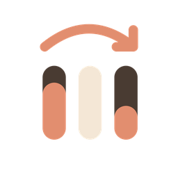
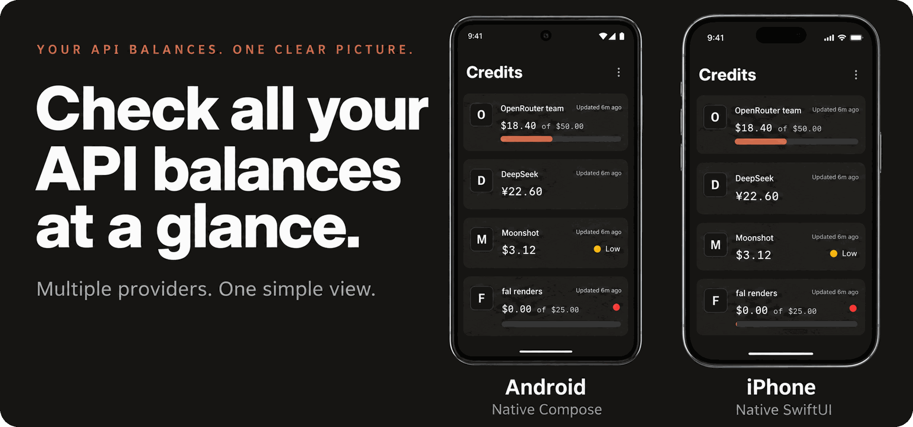
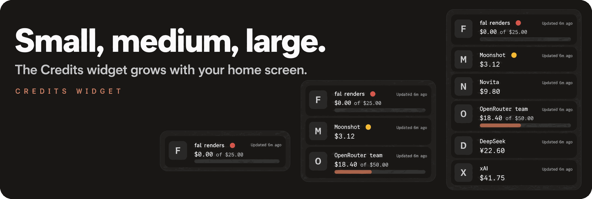

<p align="center"></p>

<h1 align="center">Usage Limits Mobile</h1>

<p align="center"><strong>How much of your AI plan is left, and when does it come back?</strong><br>One app and a few home-screen widgets that answer that for every coding assistant you pay for, plus the prepaid credit on your API accounts.</p>

<p align="center">
<a href="#build-it-yourself"></a> <a href="#build-it-yourself"></a> <a href="#build-it-yourself"></a>
</p>

<p align="center"><a href="#what-the-app-does">What it does</a> · <a href="#supported-services">Services</a> · <a href="#prepaid-credits">Credits</a> · <a href="#widgets">Widgets</a> · <a href="#your-data">Your data</a> · <a href="#build-it-yourself">Build</a></p>

<p align="center"></p>

> **Development preview.** Usage Limits is not in the app stores yet. You can build it
> yourself (see below) or grab the debug APK from the latest Android run under *Actions*.

<p align="center"><a href="https://rookieenough.github.io/Orion-Data/redirect.html?id=firefin"></a></p>

## What the app does

You connect the AI subscriptions you use. The app reads how much of each limit is used and
when it resets, and shows it in three places:

| Overview | Resets | Widgets |
| :--- | :--- | :--- |
| Every account at a glance, with the one closest to running out at the top. | A timeline of what comes back next, and when. | The same numbers on your home screen, without opening the app. |

Some details that make it pleasant to live with:

- **Several accounts per service.** Personal and work Claude, two Codex plans, whatever you
  have. Each one keeps its own limits.
- **Honest when it doesn't know.** If a refresh fails, you keep the last numbers you had,
  clearly marked as old, instead of a blank screen. If a limit has reset since the last
  refresh, it is shown as "reset due", not as still used up.
- **No model calls.** The app only asks each service for your usage. It never sends a prompt,
  so checking your limits never costs you any of them.
- **One look for everything.** Neutral colours for everything around your data, a single
  Terracotta colour for the bars and rings that matter, and the limit closest to running out
  right at the top.


## Supported services

| Service | What you see | How you connect |
| :--- | :--- | :--- |
| **OpenAI Codex** | Five-hour and weekly limits, plan limits, reset credits | Sign in through your browser (or a device code) |
| **Claude** | Five-hour, weekly and per-model limits | Sign in through your browser |
| **Antigravity** | Quota per model | Sign in with Google in your browser |
| **Grok** | Weekly credits and the monthly billing window | Device code |
| **Kimi Code** | Coding quota and its reset times, on kimi.com or kimi.ai | Device code, or a key from your Kimi console |
| **Devin** | Daily and weekly seat quota | Sign in through your browser |
| **Meta Muse** | Rolling window and weekly quota | Device code |
| **Z.ai GLM Coding Plan** | Five-hour, weekly and monthly limits, on z.ai or bigmodel.cn | API key |
| **OpenCode Go** | Five-hour, weekly and monthly limits | API key |

Both Android and iOS support all nine. Not every sign-in has been tried with a real account
yet, and Kimi may still need to approve the app's name before its sign-in can read usage
(a pasted key works either way).

**Why isn't my service here?** Some were looked at and left out on purpose. GitHub Copilot
and Warp only answer apps that pretend to be their own tools. Gemini CLI no longer accepts
personal Google accounts (Antigravity covers that now). Cursor, Perplexity, Mistral, Zed and
Qwen only work with browser cookies. Vertex AI counts quota per cloud project, not per person.
The full reasoning is in [provider research](docs/provider-auth-research.md).

### Signing in

For Claude, Codex, Antigravity and Devin you sign in on the service's own web page, in your
normal browser. The app never sees your password; it only receives the sign-in result.

While that page is open you'll see a small **Sign-in** notification. It keeps the app awake
so it can catch the result: Android 14 and later otherwise pause apps in the background,
which used to make the last step load forever. If signing in takes longer than three
minutes, the notification asks you to come back to the app, and that finishes it.

## Prepaid credits

If you use AI through API keys, the **Credits** section shows how much money is left on
each account, in that account's currency, and warns you when it gets low.

<p align="center"><a href="docs/01-terracotta/credits-devices.png"></a></p>

| Service | Which key it needs |
| :--- | :--- |
| **OpenRouter** | A management key shows the whole account; a normal key shows that key's own limit |
| **DeepSeek** | Your normal API key |
| **Moonshot (Kimi API)** | Your platform API key, for the international or the China site |
| **xAI** | A management key (the team is found automatically, or you type it in) |
| **fal.ai** | A key with billing access |
| **Novita** | Your normal API key |

**Anthropic and OpenAI can't be shown.** Neither offers a way to read the remaining balance
with an API key, so the app says so instead of guessing.

You can set your own "low" threshold per account. Credits refresh together with your usage,
and the Credits widget puts the lowest balances on your home screen in three sizes:

<p align="center"><a href="docs/01-terracotta/credits-widgets.png"></a></p>

More in [docs/credits.md](docs/credits.md).

## Widgets

Pick the style that fits your home screen:

- **Usage Summary:** one account in a compact row, with both limits and the next reset.
- **Usage Bars:** a list of accounts with their bars and reset times.
- **Account Rings:** a ring around each service's logo, with the name and reset time.
- **Mini Rings:** small rings, as many as fit.
- **Credits:** your prepaid balances, the lowest one first.

<p align="center"><a href="docs/01-terracotta/widgets-gallery.png"></a></p>

Each widget can show every account, one service, one account, or your own selection in your
own order. On Android you also choose the background colour, how see-through it is, and the
text colour. Widgets show the last numbers the app fetched; tapping refresh asks for new ones
on Android and opens the app on iOS.

<p align="center"><a href="docs/01-terracotta/rings-multiaccount.png"></a></p>

<details>
<summary><strong>Which widgets work on which iOS version</strong></summary>

<p align="center"><a href="docs/01-terracotta/ios-widget-gallery.png"></a></p>

| Widget | iOS | Notes |
| :--- | :--- | :--- |
| **Usage Bars** | 17+ | Small, medium and large. Choose an account, a service or your own selection. |
| **Account Rings** | 17+ | A grid of rings with names and reset times. |
| **Mini Rings** | 17+ | Compact rings with logos. |
| **Credits** | 16+ | Prepaid balances, lowest first. |
| **Usage Limits** | 16+ | Usage tiles in three sizes, also on the Lock Screen. |
| **Usage Limits (Clear)** | 16+ | The same tiles on a transparent background. |
| **Usage Ring** | 16+ | One account as a ring, also as a round Lock Screen widget. |

The iOS 16 widgets pick accounts by the app's own ranking. To choose accounts yourself, use
the iOS 17 widgets.

</details>

More about how widgets stay current: [docs/widgets.md](docs/widgets.md).

## App tour

<p align="center"><a href="docs/01-terracotta/DEMO.md"></a></p>

The [app tour](docs/01-terracotta/DEMO.md) walks through Overview, Accounts, Resets and
Settings in your browser. The tour and the usage pictures above still show the earlier look;
current screens and widgets are in [docs/redesign/after](docs/redesign/after), next to the
[old ones](docs/redesign/before).

## Your data

- **Nothing goes through us.** The app talks straight to each service with your own account.
  There is no server, no proxy and no tracking.
- **Keys and tokens stay locked away**, in the Android Keystore or the iOS Keychain. They
  are never written to the usage database and never logged.
- **Widgets only see numbers.** They read the cached usage, never your credentials.

Several services don't officially publish the usage pages the app reads, so an update on
their side can break a card until the app catches up. Details:
[security model](docs/security.md) and [verification runbook](docs/verification.md).

## Build it yourself

**Android** (Android SDK 36, JDK 21):

```bash
./gradlew :app:assembleDebug        # build the app
./gradlew :app:testDebugUnitTest    # run the tests
```

**iOS** (macOS with Xcode and [XcodeGen](https://github.com/yonaskolb/XcodeGen)):

```bash
swift test --package-path ios/UsageLimitsKit   # run the shared logic tests
cd ios/UsageLimits && xcodegen generate         # create the Xcode project
```

Then open the generated project in Xcode, set up signing and run it.

## Documentation

| If you want to… | Read |
| :--- | :--- |
| check whether your phone is supported | [Device compatibility](docs/compatibility.md) |
| understand the widgets | [Widgets](docs/widgets.md) |
| know how your data is protected | [Security](docs/security.md) |
| set up a specific service | the `docs/providers-*` guides, e.g. [Codex](docs/providers-codex.md), [Kimi](docs/providers-kimi.md), [Z.ai](docs/providers-zai.md) |
| use the Credits section | [Credits](docs/credits.md) |
| work on the code | [Architecture](docs/architecture.md), [Verification](docs/verification.md), [Release guide](docs/release.md) |

Found a problem? Please open an [issue](https://github.com/ZepiGit/Usage-Limit-Viewer/issues).
