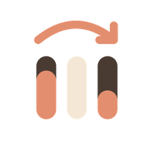
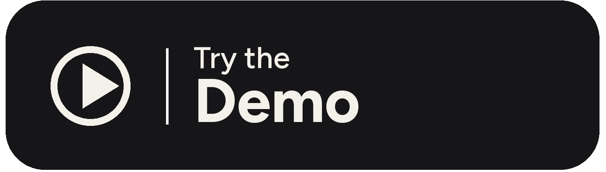
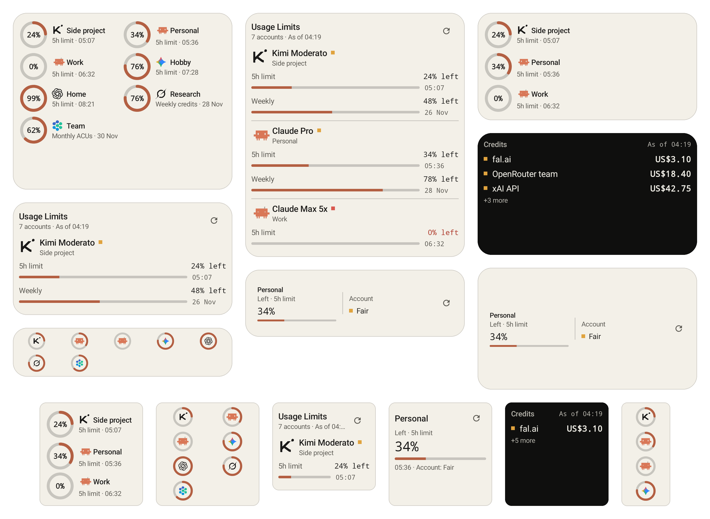

<p align="center"></p>

<h1 align="center">Usage Limits Mobile</h1>

<p align="center"><strong>Every AI limit. One glance.</strong><br>Usage and reset times for your AI subscriptions and prepaid API balances, in the app, on widgets and next to the clock.</p>

<p align="center">
  <a href="https://rookieenough.github.io/Orion-Data/app/?id=usage-limit-viewer-mobile"></a>
  &nbsp;
  <a href="https://raw.githack.com/ZepiGit/Usage-Limit-Viewer-Mobile/e63f204ab5e8e7b4ea86983734903620715d57ed/docs/demo/index.html"><picture><source media="(prefers-color-scheme: dark)" srcset="docs/images/readme/try-the-demo-dark.png"></picture></a>
</p>

<p align="center">
  <a href="https://github.com/ZepiGit/Usage-Limit-Viewer-Mobile/releases/tag/v0.5.1"></a>
  &nbsp;
  <a href="LICENSE"></a>
</p>
<p align="center">
  <a href="docs/DEVICES.md"></a>
  &nbsp;
  <a href="docs/DEVICES.md"></a>
</p>

<p align="center">
  <picture>
    <source media="(prefers-color-scheme: dark)" srcset="docs/images/readme/01-hero-dark.png">
    
  </picture>
</p>

<p align="center"><a href="#widgets">Widgets</a> · <a href="#services">Services</a> · <a href="#appearance">Appearance</a> · <a href="#your-data">Your data</a> · <a href="#install">Install</a></p>

<h2 id="widgets">
  <picture>
    <source media="(prefers-color-scheme: dark)" srcset="docs/images/readme/headings/widgets-dark.png">
    
  </picture>
</h2>


Rings, bars, summary and credit tiles in every size; the usage styles can show all accounts, one service, one account, or a Custom selection. Pin up to three usage accounts and see each glyph and headline as a status-bar notification on Android, or as the Pinned accounts Lock Screen widget on iPhone. Off until you turn it on. Credit balances cannot be pinned.

Each widget style and size has its own board in [Widgets](docs/widgets.md). Alerts and pinning are covered in [Notifications](docs/notifications.md).

<picture>
  <source media="(prefers-color-scheme: dark)" srcset="docs/images/readme/08-widgets-dark.png">
  
</picture>

<p align="center">
<picture>
  <source media="(prefers-color-scheme: dark)" srcset="docs/images/readme/06-notifications-dark.png">
  
</picture>
</p>

<h2 id="services">
  <picture>
    <source media="(prefers-color-scheme: dark)" srcset="docs/images/readme/headings/services-dark.png">
    
  </picture>
</h2>


Eleven subscriptions and ten prepaid credit APIs, on Android and iOS, including Ollama Cloud, MiniMax Token Plan, Vercel AI Gateway, DeepInfra and TokenRouter.

The same Ollama key can be a usage account and a credit account. Anthropic and OpenAI API balances cannot be shown. [See all supported services and details →](docs/PROVIDERS.md)

<picture>
  <source media="(prefers-color-scheme: dark)" srcset="docs/images/readme/10-providers-dark.png">
  
</picture>

<h2 id="appearance">
  <picture>
    <source media="(prefers-color-scheme: dark)" srcset="docs/images/readme/headings/appearance-dark.png">
    
  </picture>
</h2>


Four themes — Warm dark, Pure black, Cool graphite and Light paper — plus bundled fonts. The Claude Code figure follows the account’s headline. English and German.

<picture>
  <source media="(prefers-color-scheme: dark)" srcset="docs/images/readme/11-themes-dark.png">
  
</picture>

<h2 id="your-data">
  <picture>
    <source media="(prefers-color-scheme: dark)" srcset="docs/images/readme/headings/your-data-dark.png">
    
  </picture>
</h2>


The app talks straight to each service. There is no server, no proxy and no tracking; keys are encrypted with an Android Keystore key, or kept in the iOS Keychain. Widgets only see cached numbers. See [Security](docs/security.md). Phones, tablets and widget sizes are in [Devices](docs/DEVICES.md).

<h2 id="install">
  <picture>
    <source media="(prefers-color-scheme: dark)" srcset="docs/images/readme/headings/install-dark.png">
    
  </picture>
</h2>


Get the signed Android APK of [0.5.1](https://github.com/ZepiGit/Usage-Limit-Viewer-Mobile/releases/tag/v0.5.1) from GitHub Releases or from the Orion Store:&nbsp;<a href="https://rookieenough.github.io/Orion-Data/app/?id=usage-limit-viewer-mobile"></a>

**Android** (SDK Platform 37, JDK 21), from the repository root:

```bash
./gradlew :app:assembleDebug        # build the app
./gradlew :app:testDebugUnitTest    # run the tests
```

**iOS** (macOS with Xcode and [XcodeGen](https://github.com/yonaskolb/XcodeGen)):

```bash
swift test --package-path ios/UsageLimitsKit   # run the shared logic tests
cd ios/UsageLimits && xcodegen generate         # create the Xcode project
```

Open the generated project in Xcode to sign and run it. 0.5.1 also ships an unsigned iOS archive; this repository has no App Store listing.

A [click-through demo](https://raw.githack.com/ZepiGit/Usage-Limit-Viewer-Mobile/e63f204ab5e8e7b4ea86983734903620715d57ed/docs/demo/index.html) shows the screens in a browser. Build notes and the rest of the reference are in [Details](docs/DETAILS.md). Found a problem? Open an [issue](https://github.com/ZepiGit/Usage-Limit-Viewer-Mobile/issues/new/choose).

[MIT](LICENSE), copyright (c) 2026 ZepiGit.
