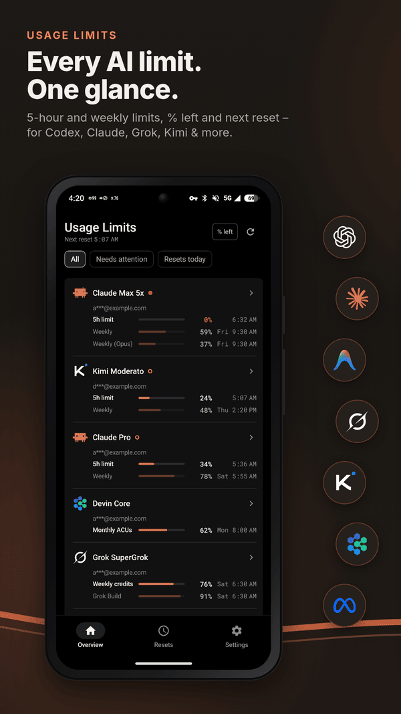
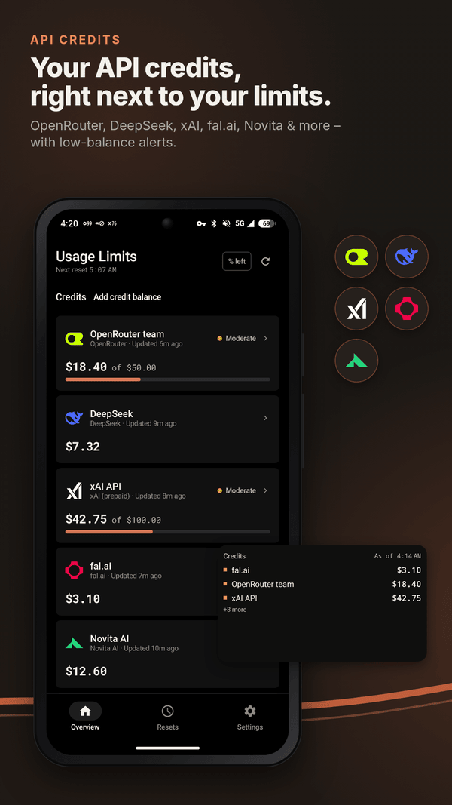
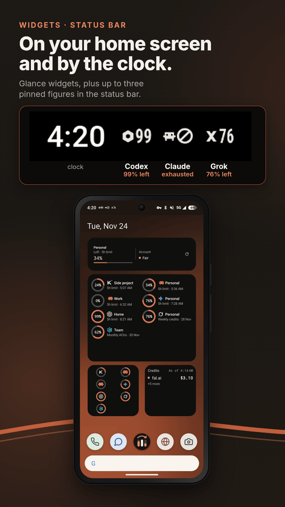
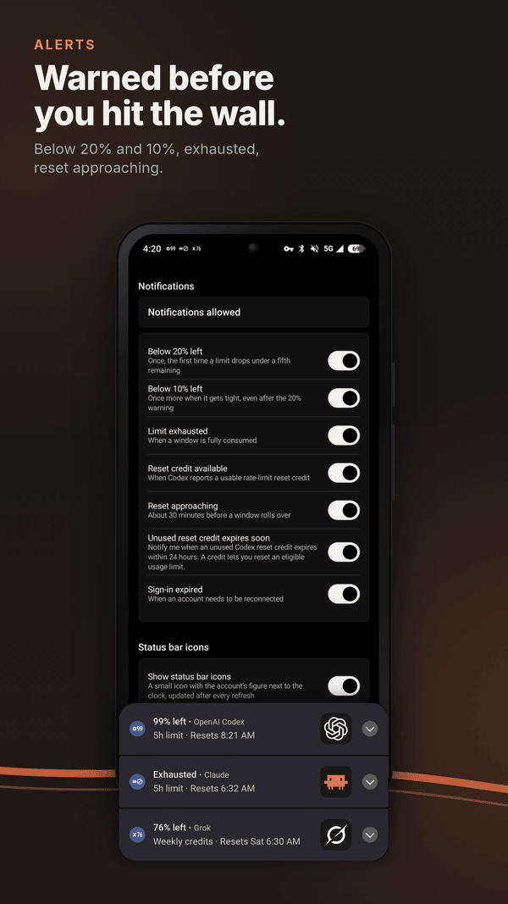
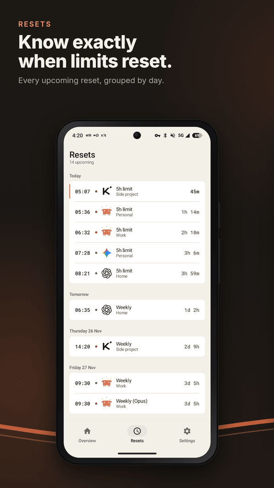
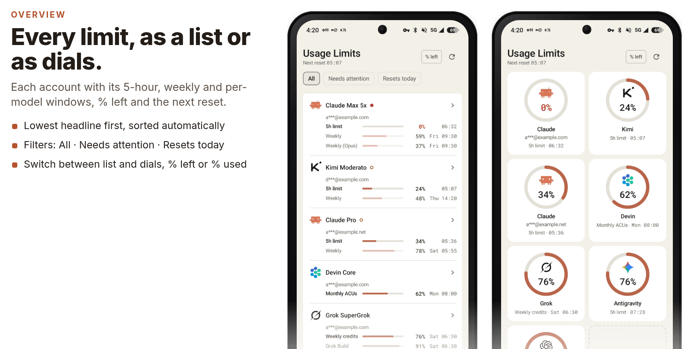
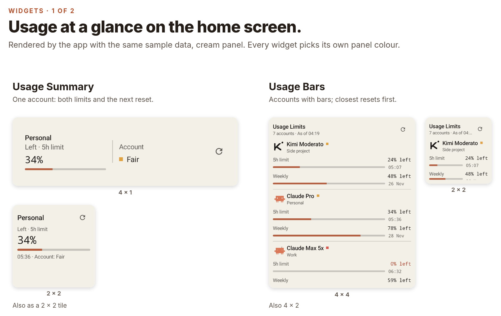
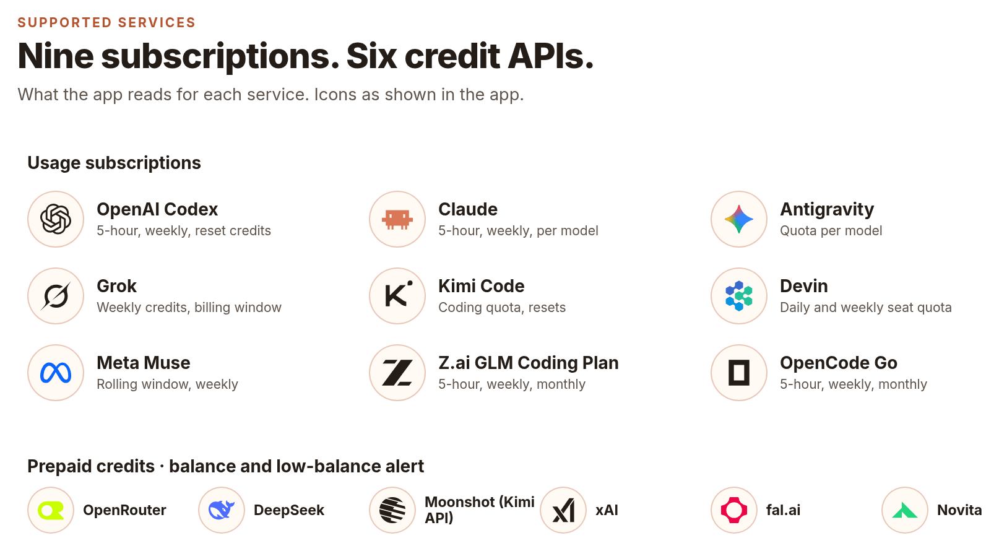

<h1 align="center">Usage Limits Mobile</h1>

Usage readings and reset times for supported AI subscriptions, plus prepaid API balances, in the app and on home-screen widgets.

  
  &nbsp;
  
  &nbsp;
  
  &nbsp;
  

  <picture>
    <source media="(prefers-color-scheme: dark)" srcset="docs/images/readme/01-hero-dark.png">
    
  </picture>

<table>
  <tr>
    <td align="center" width="20%"></td>
    <td align="center" width="20%"></td>
    <td align="center" width="20%"></td>
    <td align="center" width="20%"></td>
    <td align="center" width="20%"></td>
  </tr>
</table>

<a href="#features">Features</a> · <a href="#widgets">Widgets</a> · <a href="#services">Services</a> · <a href="#appearance">Appearance</a> · <a href="#your-data">Privacy</a> · <a href="#install">Install</a>

## Features

Connect a supported subscription to read its usage windows and reset times, as a list or as dials.

<picture>
  <source media="(prefers-color-scheme: dark)" srcset="docs/images/readme/02-overview-dark.png">
  
</picture>

## Widgets

Five home-screen styles, each able to show all accounts, one service, one account, or a Custom selection.

<picture>
  <source media="(prefers-color-scheme: dark)" srcset="docs/images/readme/08-widgets-usage-dark.png">
  
</picture>

## Services

Nine subscriptions and six prepaid credit APIs, on both Android and iOS.

<picture>
  <source media="(prefers-color-scheme: dark)" srcset="docs/images/readme/10-providers-dark.png">
  
</picture>

## Appearance

Four themes — Warm dark, Pure black, Cool graphite and Light paper — plus bundled fonts. The Claude Code figure follows how much of the account's headline is left.

<picture>
  <source media="(prefers-color-scheme: dark)" srcset="docs/images/readme/11-themes-dark.png">
  
</picture>

## Your data

The app talks straight to each service with your own account. There is no server, no proxy and no tracking; keys stay in the Android Keystore or the iOS Keychain.

## Install

Get the signed Android APK of [0.5.0](https://github.com/ZepiGit/Usage-Limit-Viewer-Mobile/releases/tag/v0.5.0) from GitHub Releases or from the Orion Store:&nbsp;

Build steps, tables and the rest of the reference are in [Details](docs/DETAILS.md).

[MIT](LICENSE), copyright (c) 2026 ZepiGit.
