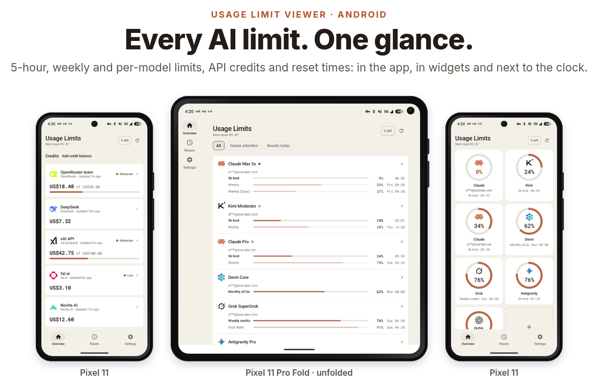
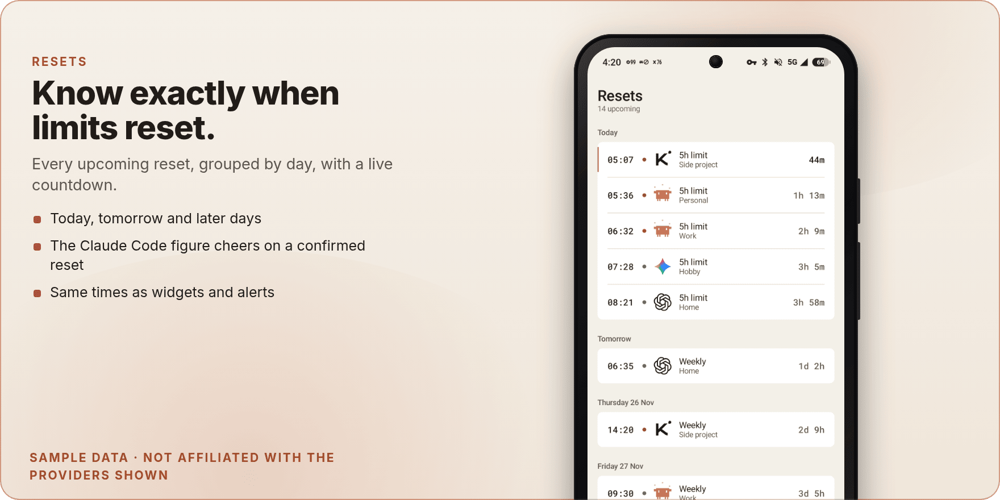
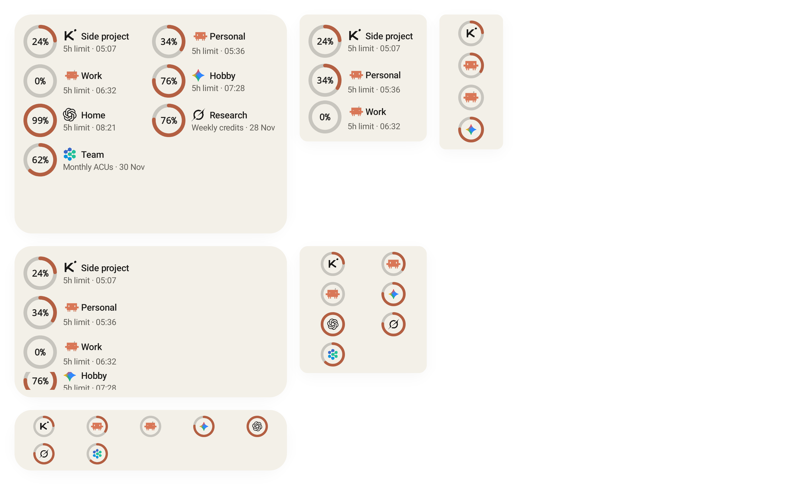
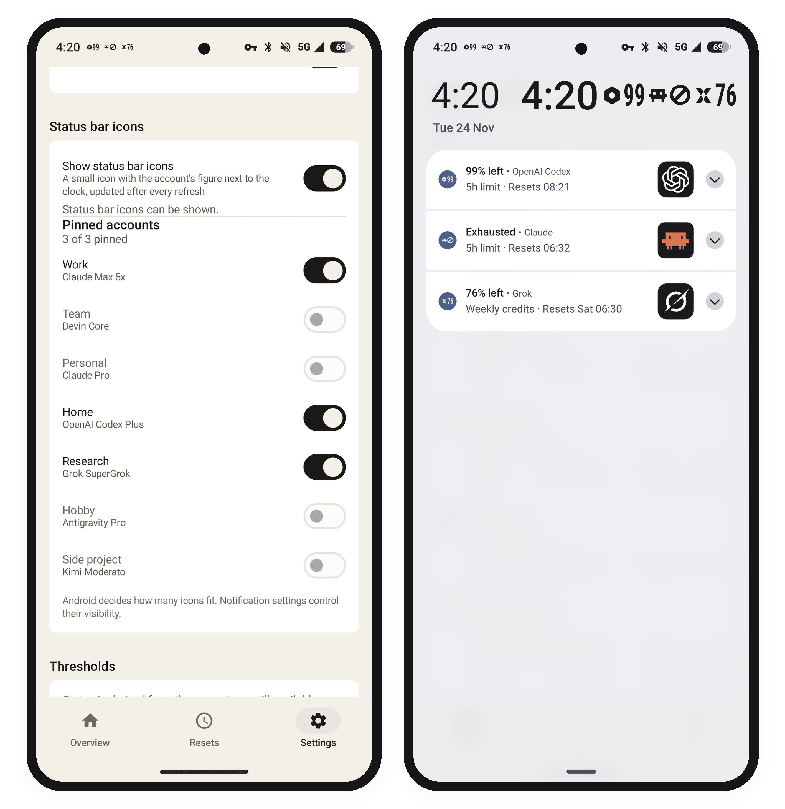
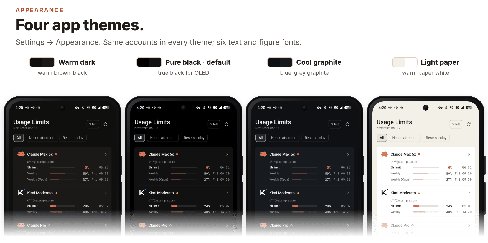

<p align="center"></p>

<h1 align="center">Usage Limits Mobile</h1>

<p align="center">Usage readings and reset times for supported AI subscriptions, plus prepaid API balances, in the app and on home-screen widgets.</p>

<p align="center">
  <a href="https://rookieenough.github.io/Orion-Data/app/?id=usage-limit-viewer-mobile"></a>
  &nbsp;
  <a href="https://raw.githack.com/ZepiGit/Usage-Limit-Viewer-Mobile/readme-preview/docs/demo/index.html"></a>
  &nbsp;
  <a href="https://github.com/ZepiGit/Usage-Limit-Viewer-Mobile/releases/tag/v0.5.1"></a>
  &nbsp;
  <a href="LICENSE"></a>
</p>

<p align="center">
  <picture>
    <source media="(prefers-color-scheme: dark)" srcset="docs/images/readme/01-hero-dark.png">
    
  </picture>
</p>

<p align="center"><a href="#features">Features</a> · <a href="#widgets">Widgets</a> · <a href="#services">Services</a> · <a href="#appearance">Appearance</a> · <a href="#your-data">Privacy</a> · <a href="#install">Install</a></p>

<h2 id="features">
  <picture>
    <source media="(prefers-color-scheme: dark)" srcset="docs/images/readme/headings/features-dark.png">
    
  </picture>
</h2>


Connect a supported subscription to read its usage windows and reset times, as a list or as dials. Overview sorts lowest headline first. Resets are grouped by day, with a live countdown.

<picture>
  <source media="(prefers-color-scheme: dark)" srcset="docs/images/readme/03-resets-dark.png">
  
</picture>

<h2 id="widgets">
  <picture>
    <source media="(prefers-color-scheme: dark)" srcset="docs/images/readme/headings/widgets-dark.png">
    
  </picture>
</h2>


Account Rings and Mini Rings can show all accounts, one service, one account, or a Custom selection. Pin up to three usage accounts and see each glyph and headline as a status-bar notification on Android, or as the Pinned accounts Lock Screen widget on iPhone. Off until you turn it on. Credit balances cannot be pinned.

Every widget style and size, including Usage Bars, Usage Summary and Credits, is in [Widgets](docs/widgets.md). Alerts and pinning are covered in [Notifications](docs/notifications.md).

<picture>
  <source media="(prefers-color-scheme: dark)" srcset="docs/images/readme/08-widgets-rings-dark.png">
  
</picture>

<picture>
  <source media="(prefers-color-scheme: dark)" srcset="docs/images/readme/06-notifications-dark.png">
  
</picture>

<h2 id="services">
  <picture>
    <source media="(prefers-color-scheme: dark)" srcset="docs/images/readme/headings/services-dark.png">
    
  </picture>
</h2>


Eleven subscriptions and ten prepaid credit APIs, on Android and iOS.

**Subscriptions:** OpenAI Codex, Claude, Antigravity, Grok, Kimi Code, Devin, Meta Muse, Z.ai GLM Coding Plan, OpenCode Go, Ollama Cloud, MiniMax Token Plan.

**Credit APIs:** OpenRouter, DeepSeek, Moonshot (Kimi API), xAI, fal.ai, Novita, Vercel AI Gateway, DeepInfra, TokenRouter, Ollama Cloud.

The same Ollama key can be a usage account and a credit account. Anthropic and OpenAI API balances cannot be shown. [See all supported services and details →](docs/PROVIDERS.md)

<picture>
  <source media="(prefers-color-scheme: dark)" srcset="docs/images/readme/10-providers-dark.png">
  
</picture>

<h2 id="appearance">
  <picture>
    <source media="(prefers-color-scheme: dark)" srcset="docs/images/readme/headings/appearance-dark.png">
    
  </picture>
</h2>


Four themes — Warm dark, Pure black, Cool graphite and Light paper — plus bundled fonts. The Claude Code figure follows the account’s headline. English and German.

<picture>
  <source media="(prefers-color-scheme: dark)" srcset="docs/images/readme/11-themes-dark.png">
  
</picture>

<h2 id="your-data">
  <picture>
    <source media="(prefers-color-scheme: dark)" srcset="docs/images/readme/headings/your-data-dark.png">
    
  </picture>
</h2>


The app talks straight to each service. There is no server, no proxy and no tracking; keys stay in the Android Keystore or the iOS Keychain. Widgets only see cached numbers. See [Security](docs/security.md). Phones, foldables, tablets and widget sizes are in [Devices](docs/DEVICES.md).

<h2 id="install">
  <picture>
    <source media="(prefers-color-scheme: dark)" srcset="docs/images/readme/headings/install-dark.png">
    
  </picture>
</h2>


Get the signed Android APK of [0.5.1](https://github.com/ZepiGit/Usage-Limit-Viewer-Mobile/releases/tag/v0.5.1) from GitHub Releases or from the Orion Store:&nbsp;<a href="https://rookieenough.github.io/Orion-Data/app/?id=usage-limit-viewer-mobile"></a>

**Android** (SDK Platform 37, JDK 21), from the repository root:

```bash
./gradlew :app:assembleDebug        # build the app
./gradlew :app:testDebugUnitTest    # run the tests
```

**iOS** (macOS with Xcode and [XcodeGen](https://github.com/yonaskolb/XcodeGen)):

```bash
swift test --package-path ios/UsageLimitsKit   # run the shared logic tests
cd ios/UsageLimits && xcodegen generate         # create the Xcode project
```

Open the generated project in Xcode to sign and run it. 0.5.1 also ships an unsigned iOS archive; this repository has no App Store listing.

A [click-through demo](https://raw.githack.com/ZepiGit/Usage-Limit-Viewer-Mobile/readme-preview/docs/demo/index.html) shows the screens in a browser. Build notes and the rest of the reference are in [Details](docs/DETAILS.md). Found a problem? Open an [issue](https://github.com/ZepiGit/Usage-Limit-Viewer-Mobile/issues/new/choose).

[MIT](LICENSE), copyright (c) 2026 ZepiGit.
