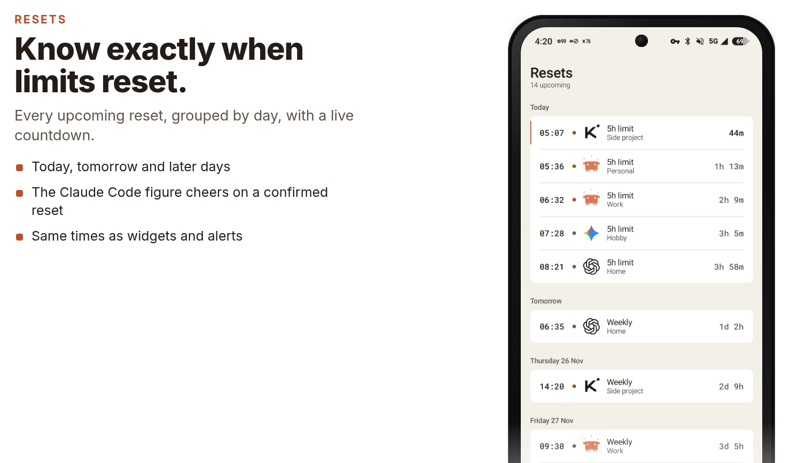
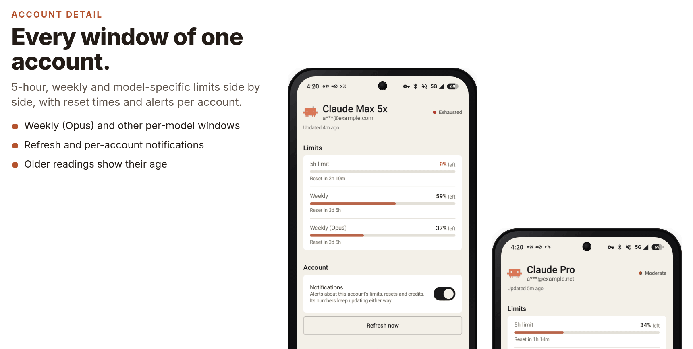
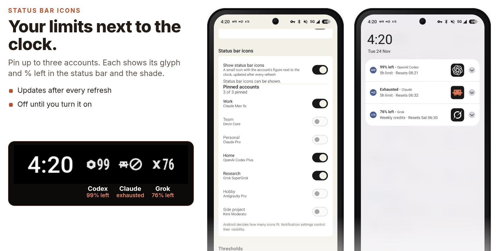
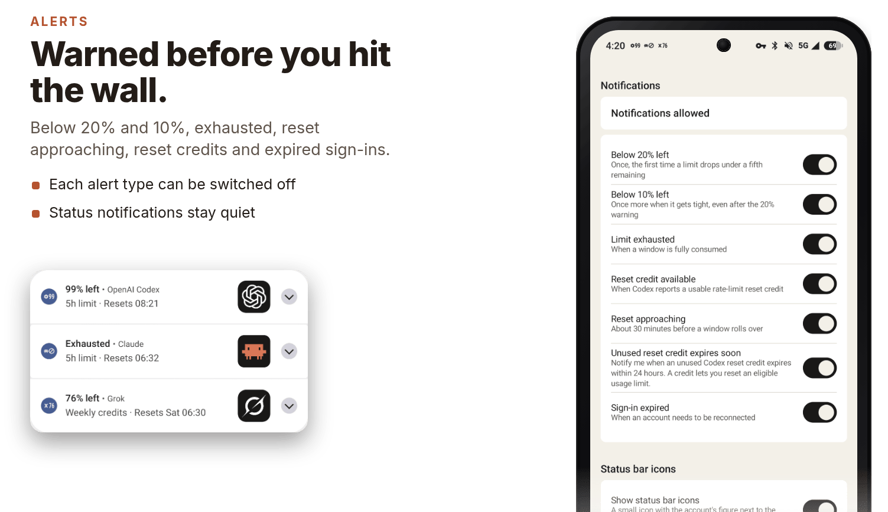
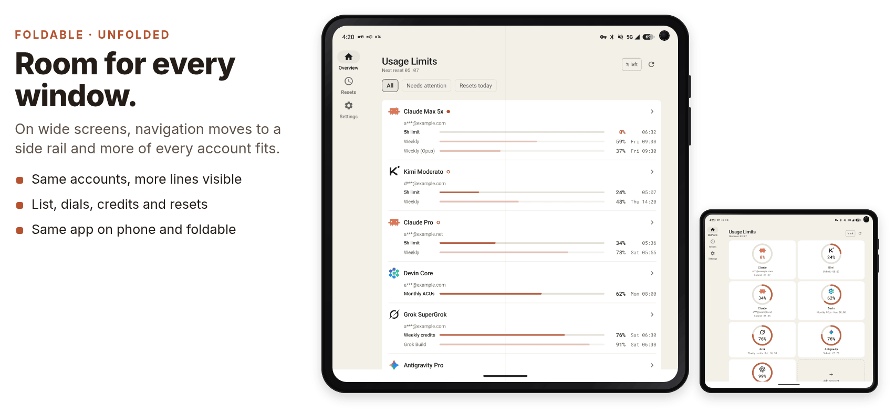
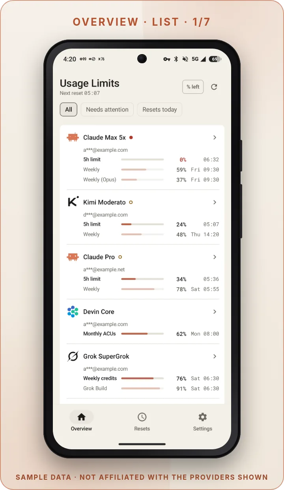
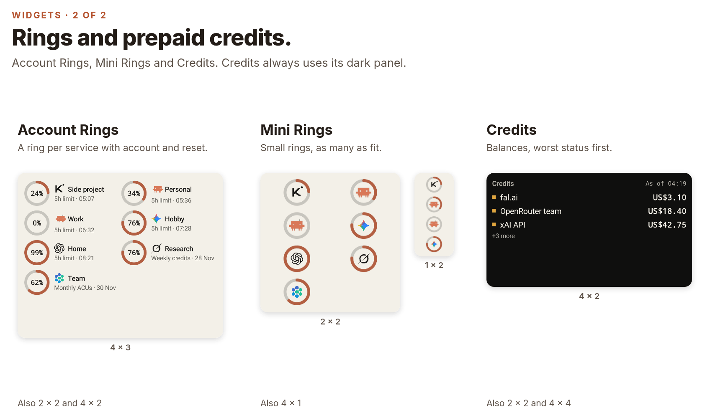
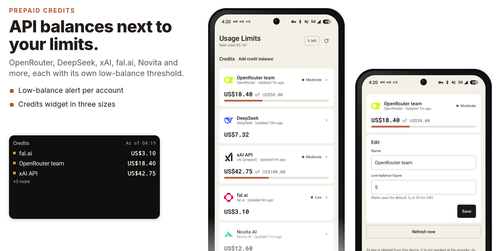
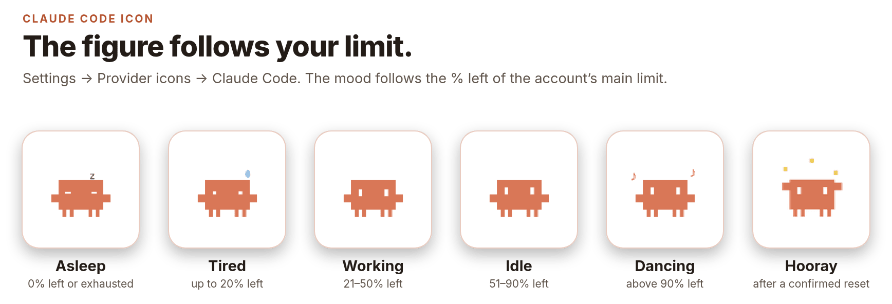

# Details

Longer notes, tables and build steps for [Usage Limits Mobile](../README.md). Both native apps have three destinations: **Overview**, **Resets** and **Settings**. Account management starts in Overview; there is no separate Accounts tab.

## Features

Choose **Settings → Overview → Layout** for **List** or **Dials**. List shows every usage window and emphasises the account's **headline**. Dials shows one headline ring per account; tap either layout for the same detail screen. Overview sorts automatically, lowest headline first. In List you can filter **All**, **Needs attention** (expired sign-ins only) or **Resets today**. **Settings → Display → Show percentages as** and the Overview chip write the same **Left/Used** choice. More detail lives in the [Overview and Settings notes](widgets.md#percentages-left-or-used) and [ADR 0002](adr/0002-one-account-headline-per-platform.md).

The app also supports several accounts per service, retained readings after a failed refresh (a passed reset is marked **Reset due**, not a fresh allowance), English and German, and it never sends a prompt — it only asks each service for your usage.

| Destination | What it shows |
| :--- | :--- |
| Overview | Usage accounts in List or Dials, plus the optional Credits block |
| Resets | Recorded upcoming resets, grouped by day |
| Settings | Appearance, display mode, Overview layout, icons, sync and notifications |

Upcoming resets, grouped by day, with a live countdown:

<picture>
  <source media="(prefers-color-scheme: dark)" srcset="images/readme/03-resets-dark.png">
  
</picture>

Every window of one account, including weekly (Opus) and other per-model limits:

<picture>
  <source media="(prefers-color-scheme: dark)" srcset="images/readme/04-account-detail-dark.png">
  
</picture>

Pin up to three accounts and see each one's glyph and figure next to the clock on Android, or on the Lock Screen on iPhone. Off until you turn it on. See [Status icons](status-icons.md).

<picture>
  <source media="(prefers-color-scheme: dark)" srcset="images/readme/05-status-bar-icons-dark.png">
  
</picture>

The app can warn you below 20% and 10% left, when a limit is exhausted, when a reset is approaching, when credits are low, and when a sign-in has expired. Each alert type can be switched off, including per account.

<picture>
  <source media="(prefers-color-scheme: dark)" srcset="images/readme/06-notifications-dark.png">
  
</picture>

The same Android build adapts to phones and foldables. On a wide inner display, navigation moves to a side rail. See [Device compatibility](compatibility.md).

<picture>
  <source media="(prefers-color-scheme: dark)" srcset="images/readme/13-foldable-showcase-dark.png">
  
</picture>

<details>
<summary>Animated tour (7 screens, Android)</summary>

<p align="center">
  <picture>
    <source media="(prefers-color-scheme: dark)" srcset="images/readme/14-app-tour-dark.webp">
    
  </picture>
</p>

</details>

## Widgets

Each configurable usage widget can show all accounts, one service, one account, or a Custom selection. Every usage widget follows the app's left/used display mode; the Credits widget shows money instead. Widgets keep their own appearance when the app's theme or fonts change, and they show cached readings. More about how they stay current: [widgets.md](widgets.md).

<picture>
  <source media="(prefers-color-scheme: dark)" srcset="images/readme/09-widgets-rings-credits-dark.png">
  
</picture>

| Style | What it shows |
| :--- | :--- |
| **Usage Summary** | One account in a compact row, with both limits and the next reset |
| **Usage Bars** | A list of accounts with their bars and reset times |
| **Account Rings** | A ring around each service's logo, with the name and reset time |
| **Mini Rings** | Small rings, as many as fit |
| **Credits** | Prepaid balances, worst status first |

### iOS widgets

| Widget | iOS | Notes |
| :--- | :--- | :--- |
| **Usage Bars** | 17+ | Small, medium and large. Choose an account, a service or your own selection. |
| **Account Rings** | 17+ | A grid of rings with names and reset times. |
| **Mini Rings** | 17+ | Compact rings with logos. |
| **Credits** | 16+ | Prepaid balances, worst status first; the small tile centers its balance and status. |
| **Usage Limits** | 16+ | Usage tiles in three sizes, also on the Lock Screen. |
| **Usage Limits (Clear)** | 16+ | The same tiles on a transparent background. |
| **Pinned accounts** | 16+ | Up to three pinned accounts on the Lock Screen, as glyph and figure. See [Status icons](status-icons.md). |
| **Usage Ring** | 16+ | One account as a ring, also as a round Lock Screen widget. |

Usage Limits, Usage Limits (Clear) and Usage Ring pick accounts by the app's own ranking. Pinned accounts shows the accounts you pin in the app. To choose accounts for a Home Screen widget, use the configurable iOS 17 widgets.

## Services

Both Android and iOS support all nine subscriptions. Not every sign-in has been tried with a real account yet, and Kimi may still need to approve the app's name before its sign-in can read usage (a pasted key works either way).

| Service | What you see | How you connect |
| :--- | :--- | :--- |
| **OpenAI Codex** | Five-hour and weekly limits, plan limits, reset credits | Sign in through your browser (or a device code) |
| **Claude** | Five-hour, weekly and per-model limits | Sign in through your browser |
| **Antigravity** | Quota per model | Sign in with Google in your browser |
| **Grok** | Weekly credits and the monthly billing window | Device code |
| **Kimi Code** | Coding quota and its reset times, on kimi.com or kimi.ai | Device code, or a key from your Kimi console |
| **Devin** | Daily and weekly seat quota | Sign in through your browser |
| **Meta Muse** | Rolling window and weekly quota | Device code |
| **Z.ai GLM Coding Plan** | Five-hour, weekly and monthly limits, on z.ai or bigmodel.cn | API key |
| **OpenCode Go** | Five-hour, weekly and monthly limits | API key |

For Claude, Codex, Antigravity and Devin you sign in on the service's own web page, in your normal browser. The app never sees your password; it only receives the sign-in result. A **Sign-in** notification keeps the app awake so it can catch that result (Android 14 and later can pause background apps while the browser is open). If signing in takes longer than three minutes, the notification asks you to come back to the app.

**Why isn't my service here?** Some were left out on purpose. GitHub Copilot and Warp only answer apps that pretend to be their own tools. Gemini CLI no longer accepts personal Google accounts (Antigravity covers that now). Cursor, Perplexity, Mistral, Zed and Qwen only work with browser cookies. Vertex AI counts quota per cloud project, not per person. See the [provider policy](release.md#owner-responsibilities).

If you use AI through API keys, the **Credits** section shows how much money is left on each account, in that account's currency, and warns you when it gets low.

<picture>
  <source media="(prefers-color-scheme: dark)" srcset="images/readme/07-api-credits-dark.png">
  
</picture>

| Service | Which key it needs |
| :--- | :--- |
| **OpenRouter** | A management key shows the whole account; a normal key shows that key's own limit |
| **DeepSeek** | Your normal API key |
| **Moonshot (Kimi API)** | Your platform API key, for the international or the China site |
| **xAI** | A management key (the team is found automatically, or you type it in) |
| **fal.ai** | A key with billing access |
| **Novita** | Your normal API key |

**Anthropic and OpenAI can't be shown.** Neither offers a way to read the remaining balance with an API key, so the app says so instead of guessing. Set a low-balance threshold per account, and choose Normal or Compact under **Settings → Overview**. See [Credit balances](credits.md).

## Appearance

The four themes and fonts affect the app, not placed widgets ([ADR 0005](adr/0005-app-and-widget-appearance.md)). Font licences are listed under **Font licences** and in the [canonical font manifest](../third_party/fonts/manifest.json).

Under **Settings → Provider icons → Claude**, the **Claude Code** choices use the account's headline for their figure. Mood uses raw percentage left, never the rounded or Used figure. In Resets the figure always uses Hooray. See [release evidence](release.md#release-050-checkpoint) for how a confirmed reset is remembered.

<picture>
  <source media="(prefers-color-scheme: dark)" srcset="images/readme/12-claude-moods-dark.png">
  
</picture>

| Raw headline percentage left | Steady mood |
| :--- | :--- |
| 0, or provider-declared exhaustion even with a positive or missing figure | Asleep |
| Above 0 through 20 | Tired |
| Above 20 through 50 | Working |
| Above 50 through 90 | Idle |
| Above 90 | Dancing |
| No known figure, without declared exhaustion | Idle |

On a German device, use **Einstellungen → Übersicht → Layout → Liste/Ringe**, **Anzeige → Prozente anzeigen als**, or **Erscheinungsbild** for **Textschrift**, **Ziffernschrift** and **Schriftlizenzen**. The List filters are **Alle**, **Braucht Aufmerksamkeit** and **Resets heute**.

## Your data

- **Keys and tokens stay locked away**, in the Android Keystore or the iOS Keychain. They are never written to the usage database and never logged.
- **Widgets only see numbers.** They read the cached usage, never your credentials.

Several services don't officially publish the usage pages the app reads, so an update on their side can break a card until the app catches up. Details: [security model](security.md) and [release checklist](release.md#device-checklist).

## Install and build

**[0.5.0 is published](https://github.com/ZepiGit/Usage-Limit-Viewer-Mobile/releases/tag/v0.5.0).** The release carries the signed Android APK and AAB, the R8 mapping and the unsigned iOS archive. Physical-device checks remain open; see [release evidence and remaining gates](release.md#release-050-checkpoint).

A debug APK from an Android run under **Actions** is a separate build; match it to its commit.

**Android** (Android SDK Platform 37, JDK 21):

```bash
./gradlew :app:assembleDebug        # build the app
./gradlew :app:testDebugUnitTest    # run the tests
```

**iOS** (macOS with Xcode and [XcodeGen](https://github.com/yonaskolb/XcodeGen)):

```bash
swift test --package-path ios/UsageLimitsKit   # run the shared logic tests
cd ios/UsageLimits && xcodegen generate         # create the Xcode project
```

Then open the generated project in Xcode, set up signing and run it.

The [click-through demo](demo/) shows the app screens in a browser. The images in the README and on this page are Robolectric captures of native Compose views in device frames; they are not physical-device photographs. Physical-device captures remain pending.

Full-size Play Store screenshots (1080×1920) are in [store-previews](store-previews/).

## Documentation

| If you want to… | Read |
| :--- | :--- |
| check whether your phone is supported | [Device compatibility](compatibility.md) |
| understand the widgets | [Widgets](widgets.md) |
| keep accounts in the status bar or on the Lock Screen | [Status icons](status-icons.md) |
| know how your data is protected | [Security](security.md) |
| set up a specific service | [Codex](providers/codex.md), [Kimi](providers/kimi.md), [Z.ai](providers/zai.md) and the other [provider guides](providers/) |
| use the Credits section | [Credits](credits.md) |

For development, read the [Architecture](architecture.md) and [Release guide](release.md). Reviews check changes against the [Coding standards](../CODING_STANDARDS.md).

Found a problem or have a feature request? Please open an [issue](https://github.com/ZepiGit/Usage-Limit-Viewer-Mobile/issues/new/choose). For vulnerabilities, follow the [security policy](../SECURITY.md) to report privately.

[MIT](../LICENSE), copyright (c) 2026 ZepiGit. Third-party artwork notices and trademark rights remain as documented in [Provider artwork](providers/assets.md).
