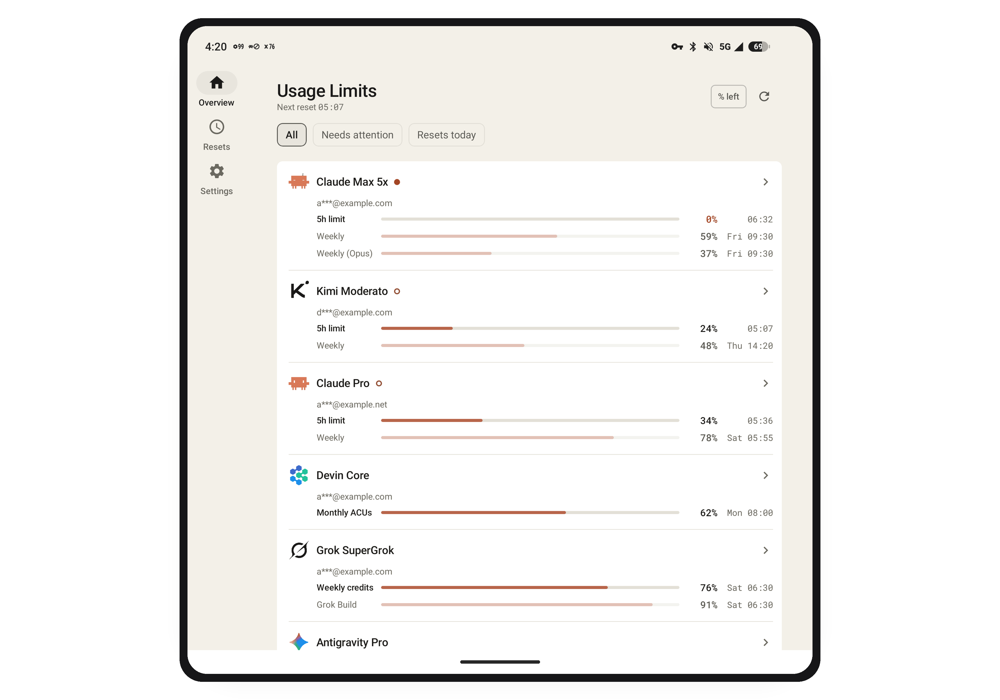

# Devices

What [Usage Limits Mobile](../README.md) 0.5.1 runs on, and how the layout and widgets adapt. Facts below come from the app’s Gradle and Xcode settings and the [widget catalog](widgets.md) (`minSdk = 26`, `compileSdk`/`targetSdk = 37`, `versionName` 0.5.1).

[Back to the README](../README.md)

## Android

Android 8.0 (API 26) or later. The app compiles and targets API 37. Use JDK 21 and Android SDK 37 for development. Notification permission is requested on Android 13 and later; viewing quotas works without it.

On Android 17, keep the browser in the same user or work profile as the app for loopback OAuth: cross-profile localhost access is blocked regardless of target SDK. Certificate Transparency is enabled by default.

The same build adapts to phones, foldables and other wide windows. Android uses **bottom navigation below 600 dp** and a **side rail in wider windows**. Content is capped at **720 dp**. Activities support resizing and rotation, including split-screen.

<picture>
  <source media="(prefers-color-scheme: dark)" srcset="images/devices/foldable-dark.png">
  
</picture>

Android launcher icons use transparent artwork; the launcher controls any additional frame or background. These icons do not supply monochrome themed variants.

## iOS

iOS 16 or later, on iPhone and iPad, including landscape and split view. Content is capped at **760 pt**.

Configurable usage widgets (Usage Bars, Account Rings, Mini Rings) require **iOS 17**. The standard Usage Limits tiles, Usage Limits (Clear), Usage Ring, Credits and Pinned accounts support **iOS 16**.

## Widget sizes

Widgets follow the launcher or WidgetKit family, not a fixed pixel size. Usage widgets on Android resize to the space the launcher gives them. [Widgets](widgets.md) shows these placements:

| Style | Sizes shown |
| :--- | :--- |
| Account Rings | 4×3, 4×2, 2×2 |
| Mini Rings | 4×1, 2×2, 1×2 |
| Usage Bars | 4×4, 4×2, 2×2 |
| Usage Summary | 4×2, 4×1, 2×2 |
| Credits | 4×4, 4×2, 2×2 (always the dark widget panel). Android’s smallest Credits tile has a 110 × 110 dp minimum. |

On iOS, the standard tiles have small, medium, large and rectangular Lock Screen forms. Usage Ring has small and circular Lock Screen forms. Pinned accounts has rectangular, circular and inline Lock Screen forms (see [Status icons](status-icons.md)). Credits widgets list up to one, three or six accounts depending on size, worst first.

Both platforms respect reduced motion. Status uses text and bar length as well as colour.
