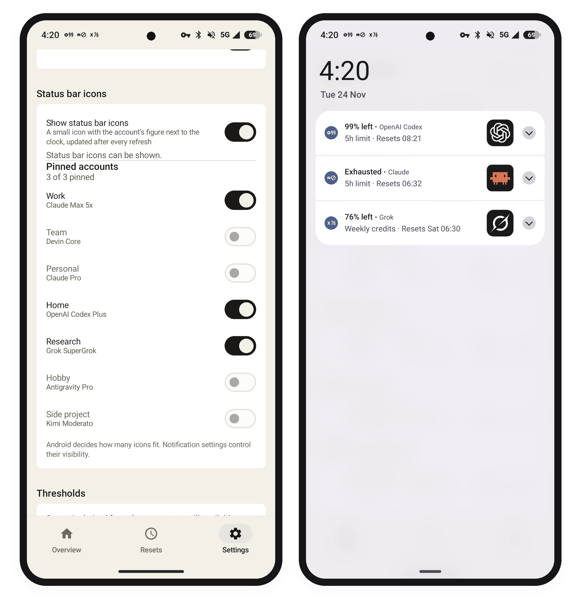

# Notifications

Pinned usage and alerts in [Usage Limits Mobile](../README.md) 0.5.1. [Back to the README](../README.md)

## Pinned usage

Pin up to three **usage** accounts. On Android each shows its glyph and headline figure as a status-bar notification, next to the clock. On iPhone the same selection is the **Pinned accounts** Lock Screen widget (iOS has no app status bar). Off until you turn it on. Credit balances cannot be pinned.

Turn it on under **Settings → Status bar icons** on Android, or **Settings → Pinned accounts → Show pinned accounts** on iOS. Android also needs notifications and the status-icon category to be allowed.

<picture>
  <source media="(prefers-color-scheme: dark)" srcset="images/readme/06-notifications-dark.png">
  
</picture>

## Alerts

The app can warn you when an account drops below 20% or 10% left, when a limit is exhausted, when a reset is approaching (off by default), when a Codex reset credit becomes available or is about to expire, and when a sign-in has expired and needs reconnecting. Each type can be switched off, including per account. The status notifications above stay quiet.

Prepaid balances are not part of alerts: a credit account can be marked **low** inside the app ([Credit balances](credits.md)).

Glyphs, Lock Screen forms and the evidence behind them are in [Status icons](status-icons.md).
