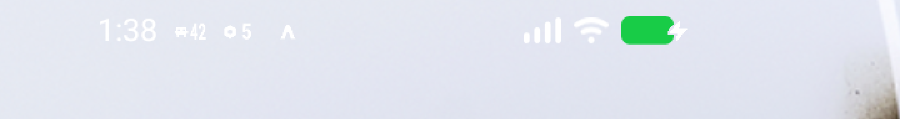
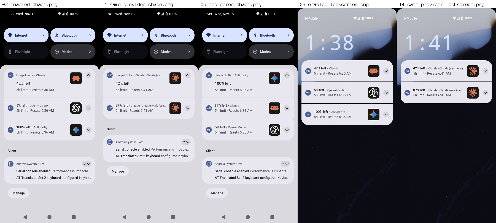

# Status icons

A status icon keeps one account in view while you use other apps: the provider glyph and a short form of the figure of the account's headline, the one usage window that speaks for the account at that moment. You pin up to three usage accounts. On Android each one becomes a notification whose icon sits in the status bar. iOS lets no app put anything into its status bar, so the Pinned accounts Lock Screen widget stands in: its rectangular and circular forms show the same icons, and the inline form a glyph with readable text.

The figure follows the app's display mode, Left or Used. Status icons are off until you turn them on. Credit balances cannot be pinned, because they have no percentage.

Why it is built this way is recorded in [ADR 0003](adr/0003-status-icons-and-lock-screen-substitute.md).

## Setup on Android

1. Open Settings and find **Status bar icons**.
2. Turn on **Show status bar icons**. If notifications are not allowed, the app asks for permission on Android 13 and later while Android still offers its dialog; otherwise, and on Android 12 and earlier, where notifications are on by default but can be switched off for the app, it opens Android's notification settings for the app. Until notifications are allowed, the section says "Status bar icons cannot be shown until notifications are allowed." The **Notifications** card in Settings offers the same way back later. If you switched off only the **Status bar icons** notification category, alerts still arrive and the section says "Status bar icons cannot be shown while their notification category is turned off.", with **Open category settings** to switch it on again. Back in the app, every pinned account's icon appears without waiting for a sync, whichever of the two you switched on, also one you had swiped away: allowing them again counts like turning the feature on.
3. Under **Pinned accounts**, pin up to three accounts. With three pinned, the section reads "3 of 3 pinned" and the other accounts cannot be pinned until you unpin one.

Turning the switch on or off, pinning and unpinning make the app post or remove the icons without waiting for a sync. After that the icons follow every refresh, by hand or in the background. When a reading turns stale or a reset time passes without a refresh, the app schedules a repaint for that moment; Android may run it later. Removing an account also releases its pin.

<em>Android 16 emulator in CI, status bar enlarged four times: Claude 42, Codex 5, Antigravity at 100 (glyph alone). Synthetic accounts.</em>

<em>Android 17 emulator in CI, with "Hide silent notifications in status bar" left at its default (on): Claude 42, Codex 5, Antigravity glyph alone.</em>

## Setup on iOS

1. In the app, open Settings → **Pinned accounts**, turn on **Show pinned accounts** and pin up to three accounts.
2. Touch and hold the Lock Screen and tap Customize. For the inline form, tap the date above the clock and choose Pinned accounts. For the rectangular or circular form, tap the widget area below the clock and add Pinned accounts there.

The widget has no settings of its own; pins and order come from the app. With the feature off or nothing pinned, the rectangular form shows "Pin an account in Settings", the circular form a pin symbol, and the inline form "Pin in Settings".

## What the icon shows

The app decides in this order; the first that applies wins:

| You see | When |
| --- | --- |
| "!" | The last refresh failed, or the account needs signing in again. A partial result with a usable headline does not count as a failed refresh. |
| Crossed circle | The headline is exhausted, in either display mode. |
| Dash | The account has no headline yet, or its provider reports no percentage. |
| Glyph alone | The figure is exactly 100. |
| Glyph and a number, such as 42 or 5 | Any other figure, written without a leading zero. "<1" is shown as 0 and ">99" as 99. |

An underline under the number or the lone glyph means the reading is stale or its reset time has passed since it was read; the last figure stays. The other signs are never underlined.

If a provider rate-limits the app, automatic refresh for that account pauses for 15 minutes to 6 hours; if the refresh failed and you see "!", you can refresh manually to try again or wait for the pause to end.

<em>Every state for every provider, drawn by the app's own renderer in a unit test at xxhdpi size, not captured on a device. The last row is the disc used for a provider the app does not know.</em>

## Android notification rows

Pulling down the shade shows one row per account whose notification is showing. Tapping a row opens that account's detail screen.

- **Title:** the figure with its side, such as "42% left", or the state in words: "Exhausted", "No percentage reported", "Refresh failed", "Reconnect required". When the icon is underlined, the title adds ", may be out of date". Written figures keep the full value, such as "<1% left".
- **Text below:** the window and its next reset, such as "5h limit · Resets 6:36 AM"; only the window when no reset is known, "Reset due" once it has passed, and no text when the account has no headline.
- **Header:** Android's standard header with "Usage Limits" and the provider's name ("Claude", "OpenAI Codex"). When two pinned accounts have the same provider, the account name follows it ("Claude · Claude work"). Some collapsed views hide the header.
- **Large icon:** the provider artwork you chose under Provider icons, without a text description. White marks are drawn on a dark tile.

The provider's name is in the header as text that accessibility services can read; what TalkBack actually says has not been checked.

The notifications use their own channel, **Status bar icons**, separate from usage alerts. The app creates it with default importance and no sound, vibration, light or badge, and asks Android not to alert for the group. The rows therefore sort with normal notifications rather than under "Silent".

<em>Android 16 emulator in CI, synthetic accounts. From left: the shade with three pinned accounts; two Claude accounts, told apart by name in the header; the shade after reordering accounts in the app; the lock screen with three accounts; the lock screen with only the two Claude accounts pinned. The lock screen is the emulator's swipe lock without a PIN.</em>

## iOS Lock Screen forms

- **Rectangular:** up to three cells side by side in the app's account order, each a glyph and its content as in the table above.
- **Circular:** the first pinned account, drawn like one rectangular cell, on the accessory background.
- **Inline:** the first pinned account only. The widget hands iOS its glyph as the line's one image and its figure with the side as the text, "42% left", or a word for a state without a number ("Exhausted", "Error", "Sign-in expired", "Unknown"). An outdated figure adds "· Stale", because the inline line cannot be underlined. Apple allows one line of text and at most one image there; use the rectangular form to see all three accounts. Whether a real Lock Screen shows the glyph and the whole text has not been checked yet.

Each cell's accessibility label is the account's title (provider, plus plan where known), the full figure with its side ("42% remaining") or the state, and "Stale" for an outdated reading. Two accounts with the same provider and plan get the same title.

If the widget cannot read the app's data before the first unlock after a restart, it shows "Locked" (the circular form a lock symbol) and asks iOS to try again in 15 minutes.

<em>View renderings at the three accessory sizes, made on macOS in CI with synthetic accounts, white on black. These are not Lock Screen screenshots: there is no wallpaper and no system tinting, and the third column is the app's inline view, not the system's inline slot.</em>

## Swiping an icon away

On Android 14 and later you can swipe a status notification away while the phone is unlocked. It normally comes back with the next sync, as long as the account is still pinned and notifications are allowed. Changing a setting, reordering accounts or pinning another account does not bring it back sooner. Turning the switch off and on, or unpinning and pinning the account again, makes the app post it again without waiting for a sync. So does allowing the app's notifications or the Status bar icons category again after they were switched off in Android: Android removed every icon then, and when you return to the app every pinned account's icon comes back, the swiped one too. An account you unpinned, or the feature switched off, while they were blocked stays that way. To get rid of an icon for good, unpin the account. On Android 13 and earlier ongoing notifications cannot be swiped away.

After the phone restarts, the icons normally return under the same conditions with the refresh that starts when you open the app, or with the next background refresh at your chosen interval if you leave it closed; Android may run it later.

This holds when a publication runs to its end. Around a crash or a permission change it is best effort:

- If the app is stopped between saving the list of accounts it means to show and posting them, the missing icons wait for the next sync.
- If that saved list is lost, a later repaint can bring back an icon you swiped away before the next sync.
- If you allow notifications or the Status bar icons category again in Android and do not return to the app, the next sync brings every pinned icon back. A repaint before that sync brings them back only if the app published while they were blocked; otherwise it shows nothing until the sync.

## Limits

- **Android does not promise that the icons are visible.** The status bar's width, cut-outs, other apps' icons, your notification settings and manufacturer versions of Android can each hide icons or fold them into an overflow dot. The Settings section says so: "Android decides how many icons fit. Notification settings control their visibility."
- **Why default importance.** From Android 16 r4 on, AOSP hides the status-bar icons of silent, low-importance notifications by default. On the Android 17 emulator that setting stayed on and still did not hide these icons, because their channel has default importance.
- **Lock screen.** The app sets no lock-screen visibility of its own, so Android decides whether the rows appear there and how much they show; the emulators already differed (see the table below). To keep them off the lock screen, turn off lock-screen display for the Status bar icons category where your Android version offers it; otherwise use the system setting, which applies to every app.
- **Order.** The app posts the icons so that they follow its account order, but Android ranks them. On the tested emulators they followed it at first post and after a reorder; on the Android 11 emulator a newly pinned account came first until the next sync. If the app detects that the clock jumped back, or the clock does not move on within a short wait, it posts the remaining icons of that publication without the order.
- **iOS updates on WidgetKit's schedule.** The widget plans its changes ahead for the moments a reading turns stale or a reset passes, but iOS decides when it redraws, so the Lock Screen can lag the app.

## What has been checked, and where

Android, CI emulators with synthetic accounts, [run 44216665612](https://github.com/ZepiGit/Usage-Limit-Viewer-Mobile/actions/runs/44216665612), method in [Status icon device evidence](status-icon-evidence.md):

| Check | Android 11 | Android 16 | Android 17 |
| --- | --- | --- | --- |
| Three icons and three rows | Yes | Yes | Yes, with the hide-silent setting on |
| Rows' place in the shade | Under "Notifications" | Alerting section | Alerting section |
| Order at first post and after a reorder | Followed | Followed | Followed |
| Newly pinned account | Came first until the next sync | In order | In order |
| Swipe away | Refused (ongoing) | Gone, returned after the sync event | Gone, returned after the sync event |
| Records with sound, vibration or light | None | None | None |
| Heads-up in the sampled frames | None | None | None |
| Lock screen (swipe lock, no PIN) | Two rows, the third icon in the overflow strip | Three rows | Icons only, no rows |

The sync here is the app's publication event fed with synthetic readings, not a real provider refresh. Tapping a row is wired in code and was not tapped in the matrix.

iOS: the widget's views were rendered on macOS in CI, in English and German, at the three accessory sizes ([run 44210074686](https://github.com/ZepiGit/Usage-Limit-Viewer-Mobile/actions/runs/44210074686)).

Not yet checked on a phone: that it stays silent and still, that a dozing screen does not light up for a changed figure, manufacturer versions of Android, a lock screen with a PIN, what TalkBack and VoiceOver say, and on iOS the real Lock Screen (inline glyph and words, system tinting, the circular background). These are in the [release device checklist](release.md#device-checklist).
