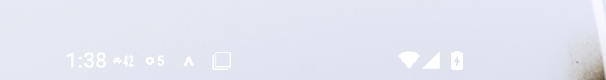
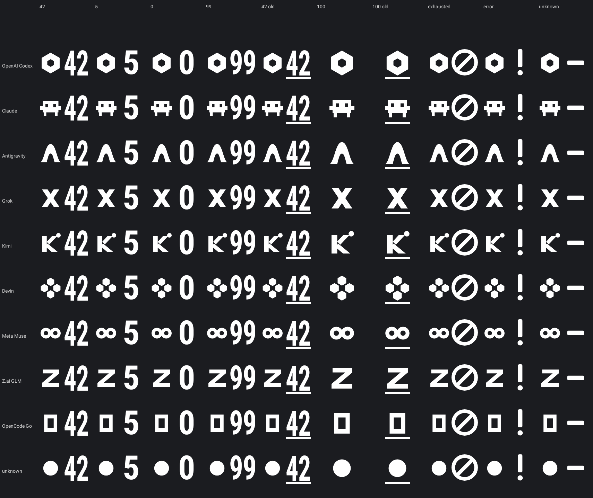
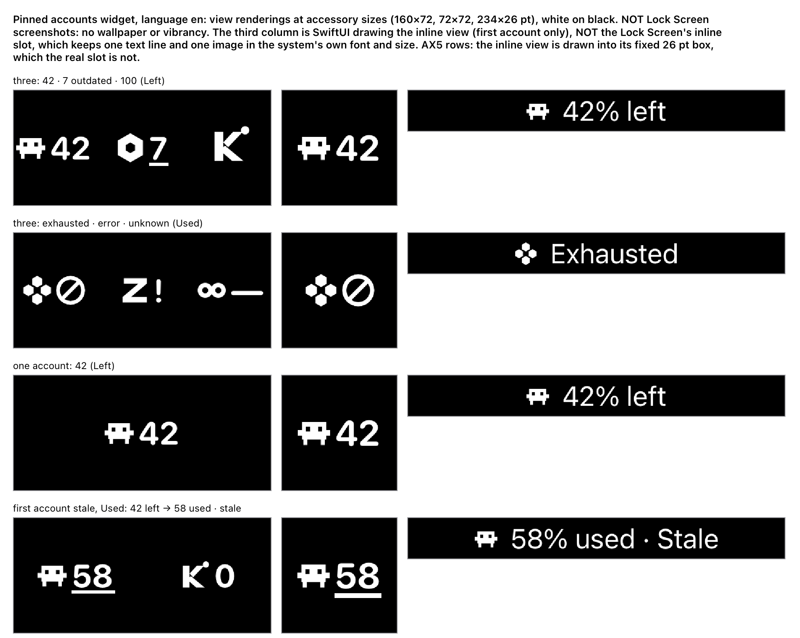

# Status icons

A status icon keeps one account in view while you use other apps: the provider glyph and the figure of the account's headline, the one usage window that speaks for the account at that moment. You pin up to three usage accounts. Android shows each one in the status bar next to the clock. iOS lets no app put anything there, so the Pinned accounts Lock Screen widget shows the same icons instead.

The figure follows the app's display mode, Left or Used, like every other surface. Status icons are off until you turn them on. Credit balances cannot be pinned, because they have no percentage.

Why it is built this way is recorded in [ADR 0003](adr/0003-status-icons-and-lock-screen-substitute.md).

## Setup on Android

1. Open Settings and find **Status bar icons**.
2. Turn on **Show status bar icons**. If notifications are not allowed, the app asks for permission now. Until you allow them, the section says "Status bar icons cannot be shown until notifications are allowed."
3. Under **Pinned accounts**, pin up to three accounts. With three pinned, the section reads "3 of 3 pinned" and the other accounts cannot be pinned until you unpin one.

The icons appear at once and change after every refresh, whether you pulled to refresh or the app refreshed in the background. They also change without a refresh when a reading turns stale or a reset time passes. Turning the switch off or unpinning an account removes its icon at once. Removing an account also releases its pin.

<em>Android 16 emulator in CI, status bar enlarged four times: Claude 42, Codex 5, Antigravity at 100 (glyph alone). Synthetic accounts.</em>

<em>The same on the Android 17 emulator, with Android's "hide silent notifications" setting left at its default.</em>

## Setup on iOS

1. In the app, open Settings → **Pinned accounts**, turn on **Show pinned accounts** and pin up to three accounts.
2. Touch and hold the Lock Screen, tap Customize, then add the **Pinned accounts** widget in one of its three forms.

The widget has no settings of its own; pins and order come from the app. With the feature off or nothing pinned, it shows "Pin an account in Settings" ("Pin in Settings" inline).

## What the icon shows

| You see | Meaning |
| --- | --- |
| Glyph and a number, such as 42 or 5 | The headline's figure from 0 to 99, without a leading zero. Under 1% shows 0, over 99% shows 99. |
| Glyph alone | The figure is 100 and the window is not exhausted, such as a fresh allowance in Left. |
| Underlined number or glyph | The reading is stale, or its reset time has passed since it was read. The last figure stays. |
| Crossed circle | The window is exhausted: nothing is left, in either display mode. |
| "!" | The last refresh failed or the account needs signing in again. The old number is not repeated. |
| Dash | The provider reports no percentage for the account, or the account has no reading yet. |

The icon's number is a shorthand. Spoken and written texts use the full figure ("<1% left", ">99% used", "100% left").

<em>Every state for every provider, drawn by the app's own renderer in a unit test at xxhdpi size, not captured on a device. The last row is the disc used for a provider the app does not know.</em>

## Android notification rows

Each status icon is a notification, so pulling down the shade shows one row per pinned account:

- The title is the figure with its side, such as "42% left", or the state in words: "Exhausted", "No percentage reported", "Refresh failed", "Reconnect required". An underlined icon adds ", may be out of date".
- Below it, the window and its next reset, such as "5h limit · Resets 6:36 AM".
- In the header, next to "Usage Limits", the provider's name ("Claude", "OpenAI Codex"). When two pinned accounts have the same provider, the account name follows it ("Claude · Claude work"), so the rows can be told apart. Screen readers get the provider's name from this header.
- On the right, the provider artwork you chose under Provider icons. White marks are drawn on a dark tile so they stay visible on a light shade.

Tapping a row opens that account. The rows never sound, vibrate or flash a light. The notifications live in their own channel, **Status bar icons**, separate from usage alerts, so turning on status icons does not change when you are alerted.

<em>Android 16 emulator in CI, synthetic accounts. From left: the shade with three pinned accounts; two Claude accounts, told apart by name in the header; the shade after reordering accounts in the app; the lock screen with three accounts; the lock screen with the two Claude accounts. The lock screen is the emulator's swipe lock screen without a PIN.</em>

## iOS Lock Screen forms

- **Rectangular:** up to three cells side by side in the app's account order, each a glyph and its content as in the table above.
- **Circular:** the first pinned account, drawn like one rectangular cell, on the system's round background.
- **Inline:** one line above the clock with the first pinned account only: its glyph, then its figure with the side, "42% left", or a word for a state without a number ("Exhausted", "Error", "Sign-in expired", "Unknown"). Apple allows one line of text and at most one image there, so the other accounts are left out; use the rectangular form to see all three. The inline line cannot be underlined, so an outdated figure says so instead: "42% left · Stale".

VoiceOver reads each account's name, the full figure and its side, and "Stale" for an outdated reading.

<em>View renderings at the three accessory sizes, made on macOS in CI with synthetic accounts, white on black. These are not Lock Screen screenshots: there is no wallpaper and no system tinting, and the third column is the app's inline view, not the system's inline slot.</em>

## Swiping an icon away

On Android 14 and later you can swipe a status notification away while the phone is unlocked. It comes back with the next sync, so a slip of the finger does not end the feature. Changing a setting, reordering accounts or pinning a different account does not bring it back sooner. Unpinning the account and pinning it again shows it at once. To get rid of an icon for good, unpin the account. On Android 13 and earlier the rows cannot be swiped away.

After a restart of the phone, the icons return with the next sync. Android decides when that runs, so it can take a while.

The rule holds when a publication runs to its end. Around a crash or a permission change it is best effort:

- If the app is stopped between saving which accounts it shows and posting them, the missing icons wait for the next sync.
- If that saved list is lost, a later repaint can bring back an icon you swiped away before the next sync.
- If you withdraw the notification permission and grant it again with no publication in between, the icons may wait for the next sync.

## Limits

- **Android does not promise that the icons are visible.** The status bar's width, cut-outs, other apps' icons, your notification settings and manufacturer versions of Android can each hide icons or fold them into an overflow dot. The Settings section says so: "Android decides how many icons fit. Notification settings control their visibility."
- **The rows sit under Notifications, not under "Silent".** The channel has normal importance so that its icons show on current Android, which hides silent notifications' icons by default. It has no sound, vibration or light.
- **The rows appear on the lock screen** the way Android shows normal notifications, under your lock-screen notification settings. To keep them off the lock screen, use Android's notification settings for Usage Limits: the **Status bar icons** category's lock-screen option where your Android version offers one, or the system's lock-screen notification setting, which applies to every app.
- **Order follows the app's account order** on the tested Android versions, including after a reorder. On the Android 11 emulator, a newly pinned account came first until the next sync put it in its place. If the phone's clock jumps back or stands still while the icons are posted, that one publication posts them without keeping the order.
- **iOS updates on WidgetKit's schedule.** The widget plans its changes ahead for the moments a reading turns stale or a reset passes, but iOS decides when it actually redraws, so the Lock Screen can lag the app.
- **The iOS inline form shows one account.** Use the rectangular form for all three.

## What has been checked, and where

On Android, CI emulators running Android 11, 16 and 17 checked the following with synthetic accounts: three icons and three rows; updates, reorder, swiping away and unpinning; the rows' section; the lock screen with the emulator's swipe lock; and that the notification records carry no sound, vibration or light and that no heads-up appeared in the sampled frames. The method is in [Status icon device evidence](status-icon-evidence.md). On iOS, CI renders the widget's views in English and German at the accessory sizes.

Nobody has checked these on a phone yet: that a phone stays silent and still (the emulator has no audio output), that a dozing screen stays dark when an icon changes (the app asks Android for this, and the emulator does not exercise it), manufacturer versions of Android, a lock screen with a PIN, and on iOS the real Lock Screen: whether the inline glyph and words show in full, the system tinting, and the circular background. These checks are in the [release device checklist](release.md#device-checklist).
