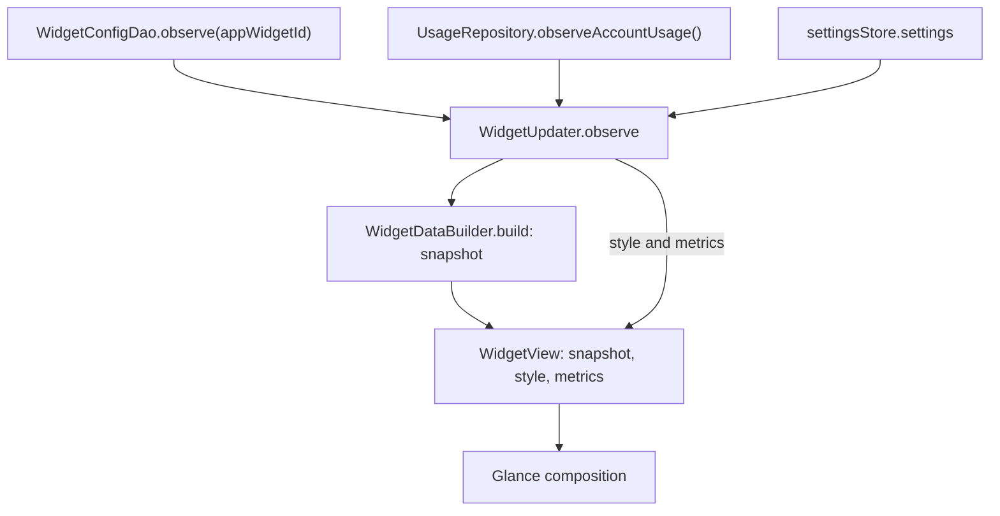

# Widgets

The widgets are the reason the app exists. Opening an app to find out whether you have Codex
quota left is only marginally better than hitting the limit and finding out the hard way; a
number on the home screen is the actual product. Everything below follows from that, including
the decision to make the widgets read a cache rather than the network.

The four usage widgets and the Credits widget below use Glance (`androidx.glance:glance-appwidget:1.2.0`), which compiles a
Compose-like description into `RemoteViews` that the launcher renders in its own process.
In `app/src/main/kotlin/com/usagelimits/widget/`, `UsageWidgets.kt` implements Summary and
Bars, and `RingWidgets.kt` implements Account Rings and Mini Rings. `WidgetData.kt` reduces
cached data, `WidgetUpdater.kt` observes it and refreshes instances, and the remaining files
handle configuration, style, layout metrics, bitmap rings, receivers and scheduled repaints.

## The four Android usage widgets

(The fifth, Credits, is covered after them.)

### Account Rings (`MinimalUsageWidget`)

Declared at 3×2 cells, resizeable in both axes down to 110×60dp. A scrollable list shows a
ring and provider icon beside each account's label and reset time or warning. It uses one
column unless both the available width (including font scale) and height/placement metrics
allow two. The ring uses the model's representative window, preferring global constraints;
an exhausted model-specific window is retained as a named restriction rather than silently
turning an available global quota into zero. Percentages are included in the ring's
accessibility description; the provider icon occupies its centre.

### Mini Rings (`MiniRingsWidget`)

Declared at 1×1 cells, resizeable in both axes down to 56×56dp. This is a fixed grid of rings
and provider icons without the adjacent account/reset text. `WidgetMetrics` estimates the
placement's cell spans, and `WidgetLayout.miniGrid` allocates two slots per estimated cell:
twice the rows in portrait, or twice the columns in landscape. Accounts beyond that capacity
are not rendered. The visible rows follow the selected account count so unused grid capacity
does not reserve empty rows. Both ring widgets show "No matching accounts" when empty.

`UsageRing.fractionFor` returns zero for missing or invalid percentages, and `UsageRing.draw`
renders those values as a dashed neutral track without a foreground arc. A reported zero
uses a solid track. A partial update adds a visible `!` badge; known exhausted quota keeps its
red accent even when an optional endpoint failed.

### Usage Summary (`CompactUsageWidget`)

Declared at `targetCellWidth="4"`, `targetCellHeight="1"`, resizeable horizontally down to
180dp. `WidgetLayout.compactLayout` chooses four tiles, two metrics or one focused readout
according to the actual width and font scale. The widest layout contains:

| Tile | Shows |
|---|---|
| **5h limit** | The leading account's global five-hour constraint, when reported |
| **Weekly / Monthly / other** | The same account's selected long-horizon constraint, retaining its label |
| **Next reset** | The next future reset for that account |
| **Account / N accounts** | The worst status across the selection, explicitly labeled with the selected account count when there is more than one |

The account owner is shown with the readings. A valid number on one account is never paired
with an unlabeled status from a different selected account. Partial updates add a separate
"Sync issue" warning. Headline windows prefer global constraints when present, and scoped
labels survive the parser-to-widget mapping. Missing percentages display "—".

### Usage Bars (`DetailedUsageWidget`)

Declared at 3×2 cells, resizeable in both axes down to 180×110dp. With multiple accounts, a
header carries "Usage Limits", "N accounts" and a refresh button above a `LazyColumn` of
account cards. With one account the outer header/card background is omitted and the account
header carries the refresh button. Accounts are not capped at three.

Each account shows its provider icon, title and account label (falling back to masked e-mail),
followed by all retained limit rows: label and remaining percentage above a bar and absolute
reset time/date. The headline horizons lead, then independently scoped and optional limits
remain available in the detail. Reconnection, failed/stale data and partial updates have
explicit warnings. `AccountLimitRows` groups and recursively splits rows to stay within
Glance's ten-direct-child limit; a third or later limit must not disappear. The empty state
reads "No matching accounts. Edit this widget to choose an account."; a provider-scoped
widget whose provider has no account reads "No <Provider> account connected. Add one in the app."

All four widgets use `SizeMode.Exact`. They consume the host's actual dimensions rather than
three predefined responsive buckets. `WidgetLayout` handles Summary width/font-scale choices
and ring columns/capacity; saved `WidgetMetrics` accounts for launcher cells that are not square.

## The configuration model

Each placed widget can show something different. `WidgetScope` names six
possibilities:

- **`MOST_CRITICAL`** — every account, ordered worst-first, so whatever is closest to running
  out leads, using severity urgency and five-point percentage bands.
- **`ACCOUNT`** — one specific account, by `localId`.
- **`PROVIDER`** — every account of one provider, by provider id.
- **`ALL_ACCOUNTS`** — everything, in the user's account order.
- **`CLOSEST_RESETS`** — every account, ordered by its next future reset. The default and fallback.
- **`CUSTOM`** — selected account IDs in the widget's saved custom order.

`MOST_CRITICAL`, `CLOSEST_RESETS` and `ALL_ACCOUNTS` select the same set with different ordering.
This determines the Summary owner and which accounts fit in Mini Rings. Stored scope names
retain their meaning; `MOST_CRITICAL` is not an alias for `CLOSEST_RESETS`.

The choice is persisted per widget in the Room table `widget_configs`, keyed by the
framework's `appWidgetId` and holding `scope`, `accountId`, `provider`, `updatedAt`, the custom
account list, the placement metrics and the widget's look — ids, numbers and enum names,
nothing else. The look is three columns added in version 9: `backgroundArgb` (the panel
colour), `backgroundOpacity` (0–100, where 0 is the old "transparent" and is what the old
`transparent` flag migrates to) and `textTone` (`AUTO`, `LIGHT` or `DARK`). Every column
added by a migration carries the same default on the entity's `@ColumnInfo`: Room compares
the declared schema against the one it finds, and a default stated in the ALTER but not on
the entity fails validation at launch.

### Background colour, opacity and ink

`WidgetStyle` turns those three columns into every colour a widget draws. The panel is the
chosen colour with the opacity folded into its alpha; the ink — text, tile and track — is
derived from the panel's luminance, so a light panel gets dark text without a second setting.
`AUTO` follows the selected panel color at every opacity, including zero. It does not
read the wallpaper or follow system theme changes. `LIGHT` and `DARK` provide explicit
text-color overrides for transparent widgets. Bars
and rings keep the raw status accents on either ink; only the words switch to the deeper
variants that clear 4.5:1 on near-white. `WidgetStyleTest` pins the derivation.

Background and foreground are resolved together from the stored per-widget style and
sent as explicit colors in `RemoteViews`. A changing launcher-rendered color does not by
itself prove a configuration write or a launcher defect. Fixed configurations are tested
through repeated compose/apply/reapply and day/night host contexts. This host-render test
is separate from physical launcher verification; changing transparency or recreating a
widget is not a substitute for identifying a reproduced lifecycle failure.

`WidgetUpdater.observe` resolves the `GlanceId` to an
`appWidgetId`, observes its configuration alongside account usage and settings, and passes
the result to `WidgetDataBuilder.build`. Both the
scope name and the enum names are part of the on-disk contract, which is why `WidgetScope`
carries a "do not rename casually" note; `WidgetScope.fromName` maps anything unrecognised —
including `null` — to `CLOSEST_RESETS` so a bad or missing row degrades to a useful widget
rather than an empty one.

**The configuration screen.** `WidgetConfigActivity` is declared as `android:configure` on
all four providers, so the launcher opens it when a widget is dropped and again on reconfigure
(`android:widgetFeatures="reconfigurable"`). It receives `EXTRA_APPWIDGET_ID`, offers the six
scope modes plus appearance controls, and on "Save widget" upserts a single
`WidgetConfigEntity` through `WidgetConfigDao`, repaints so the widget lands showing the chosen
scope, and returns `RESULT_OK` with the id.

The result is set to `RESULT_CANCELED` first and only flipped after a successful explicit save.
Cancel does not rewrite an existing widget's configuration; initial placement cancellation is
handled by the launcher. The activity is not exported; the launcher/system opens it through the
`APPWIDGET_CONFIGURE` action.

## The data path, and why a token cannot reach the home screen

All four widgets use this data path. Summary and Bars call it from their `provideGlance`
methods; Account Rings and Mini Rings share the inherited `AccountRingsWidget.provideGlance`.

Three properties make the "no token" claim structural rather than aspirational:

1. **Usage comes from Room; appearance also uses settings.** Room holds no token — `AccountEntity`
   stores a `credentialReference` (a lookup name like `claude_9f2c…`), never a credential. Even
   a bug that dumped the entire widget input would expose usage numbers and a masked e-mail.
2. **`WidgetDataBuilder` is a pure function** over already-loaded `AccountUsage` values. It
   cannot fetch, cannot decrypt and cannot suspend on anything; a token has no route in.
3. **The `widget` package imports no credential store or provider connector.** It uses models,
   cache/configuration types, scheduling, settings and UI resources such as provider logos.
   Neither `core.auth` nor the `providers` package is part of this render path.

The output type reinforces this: `WidgetSnapshot`, `WidgetAccount` and `WidgetRow` have fields
for labels, percentages, reset times and severities, and no field a credential could occupy
even by accident.

The one caveat, stated because the guarantee should not be overclaimed: `WidgetUpdater` reaches
the graph by casting `context.applicationContext` to `UsageLimitsApp`, and `AppContainer`
exposes `credentialStore` and `providerRegistry` alongside `repository`. Nothing stops a future
edit in this package from touching them — the boundary is enforced by the import list and by
review, not by the compiler. Making it airtight would mean handing `WidgetUpdater` a narrow
read-only interface (`suspend fun accountUsageOnce()` plus the config DAO) instead of the whole
container; that is the right change if this package ever grows.

Glance compositions use `androidx.glance.LocalContext`, rather than the app Compose
context; the Compose one fails composition and shows "Can't show content". Each `provideGlance`
creates its observation flow once per composition session; recomposition collects that flow
without replacing the subscription. While a session is open, `update()` sends only a state
event, so `provideGlance` does not re-run. A repaint is lost if the process dies before
`SessionWorker` starts (`No session available for key`).

## How a placed widget gets updated

Three update paths serve different triggers; Android can defer background delivery:

1. **After a sync moves the cache** (`WidgetUpdater.refreshAll`, called from
   `publishAfterSync` and foreground refresh/account actions). This requests a repaint from
   the updated cache; periodic sync and Glance session work still depend on Android scheduling.
2. **On the system's clock.** Every provider XML declares `updatePeriodMillis="1800000"`, the
   minimum interval requested from the framework, not a guarantee of exact thirty-minute
   delivery. `UsageWidgetReceiver.onUpdate` delegates the cache repaint to Glance and calls
   `SyncWorker.syncIfCacheAged`. The decision checks each account's missing/aged data and
   elapsed resets, with recent attempts limiting retries. A fresh account does not hide an
   older account that still needs a sync. Size changes are handled by Glance's size-update path.
3. **At a presentation boundary** (`WidgetPresentationWorker`): a cache-only repaint when a
   snapshot crosses its staleness threshold or a reset instant arrives, plus the same
   conditional fetch, because a reset is the one boundary a repaint cannot get right on its own.
   `publishAfterSync` reschedules it after every sync, worker or foreground.

A cache-only repaint cannot confirm a new quota window. `WidgetRow.resetElapsed` marks a
row whose reset passed after its fetch; every surface uses stale treatment and "Reset due"
until a fetch confirms the new window. The row stops deciding account severity
(`UsageSnapshot.severityAt`) and ring/most-critical representation while another window
remains open. App rows use the same rule (`UsageWindow.resetElapsedAt`).

`refreshAll` isolates failures per widget kind, rethrows cancellation and logs other failures.
If Glance's stored receiver-to-class map has no instances while the framework has placed
widgets, a framework update intent repairs the map and requests rendering. A `-keepnames`
rule preserves widget class names across minified builds. Settings diagnostics show sync and
widget-refresh timestamps alongside background restrictions; an update request is not proof
of a completed host repaint.

## Why the refresh button enqueues work instead of fetching

`RefreshWidgetAction` is an `ActionCallback` whose entire body is `SyncWorker.syncNow(context)`.
It does not call a provider, does not touch the credential store, and does not await a result.

A widget action should not perform a token refresh and provider fetch inline. The callback
enqueues work in the app; the launcher renders the resulting `RemoteViews`. Network work goes
through the normal sync path with its scheduling and concurrency controls.

Routing through WorkManager buys four things at once. The pass obeys the same
`NetworkType.CONNECTED` constraint as every other sync, so tapping refresh with no signal
queues rather than fails. It goes through the same `SyncEngine`, so it inherits per-account
failure isolation and the per-credential refresh mutex — a widget tap racing the periodic pass
cannot double-spend a refresh token. It is enqueued as unique work with
`ExistingWorkPolicy.KEEP`, so an impatient user tapping five times gets one sync. And because
the worker calls `WidgetUpdater.refreshAll` after the cache moves, every placed widget updates
from one pass rather than each fetching for itself.

The visible cost is that the refresh is not instant and the button has no spinner: the widget
keeps showing the old numbers until the pass lands, then repaints. A progress state in the
header would be an improvement, and would need a small piece of transient state the widget can
read — which today would mean another Room write.

Foreground refresh, per-account refresh, completed login, reset-credit spending and account
removal all request widget updates after changing the cache.

## Glance constraints that shaped the layout

Glance is not the app's Compose UI. It emits supported `RemoteViews` layouts for the host;
custom ring drawing is supplied as a bitmap, not a launcher-side Canvas composable. Four
consequences are visible in the code:

**The bars use Glance's own progress indicator.** `androidx.glance.appwidget.LinearProgressIndicator`
accepts a per-instance `color` and `backgroundColor` and fills whatever width its modifier
gives it, which is exactly what these bars need — the colour carries the severity and the
width has to follow the tile.

A hardcoded bar width can clip a partially filled bar into an apparently full one.
The host progress primitive resolves the fraction against the actual available width.

**No fractional width measurement.** There is still no `fillMaxWidth(fraction)` a child can
resolve against a parent whose width Glance does not know at composition time — which is why
the fraction has to be handed to a primitive that resolves it at inflation, rather than
computed in the composable. Inside the detailed row the bar takes `defaultWeight()` so it
absorbs the width left beside the fixed-width reset label.

**The stored widget style is explicit.** `WidgetStyle` owns panel, text, card, track and status
colors; `LocalWidgetStyle` supplies it during composition. The host receives those colors in
`RemoteViews` rather than inheriting the app's Material theme. Status handling distinguishes
quota severity from stale/error validity, model-specific restrictions and partial updates.
The refresh chip is a tinted `ic_refresh` drawable with a "Refresh usage" description.

**Collections can scroll; ordinary layouts can still truncate.** Usage Bars and Account Rings
use Glance `LazyColumn`; Mini Rings is a fixed-capacity grid. Glance limits a Row/Column to ten
direct children, so detailed limits use nested groups instead of one long flat card. Real host
size and font scale still matter: text can be ellipsized and a single large account card can
exceed the visible viewport. A collection adapter must be materialized when testing its
`RemoteViews`; a background-only bitmap does not verify the account rows.

Reset labels are absolute rather than a live countdown: `Countdown.absoluteResetLabel` serves
Summary, and `compactRingReset` uses the device's time format for today, a localized date for
later days, and "Reset due" for passed instants. Recomposition is driven by updates, not a
per-second timer; the presentation worker schedules reset/staleness boundaries.

## Adding another Android widget

The reducer is size-agnostic, so a new size is mostly declaration:

1. Add a `GlanceAppWidget` subclass using the existing `WidgetView` and its snapshot, style
   and metrics. Choose its size/layout policy explicitly; the current four use `SizeMode.Exact`.
   Reuse `UsageBar`, `UsageRing` and `WidgetStyle` as appropriate. The snapshot already retains
   all account limit rows; a new layout does not require a new data path.
2. Add a matching `GlanceAppWidgetReceiver` subclass.
3. Add `res/xml/widget_<name>_info.xml` with `minWidth`/`minHeight`, `minResizeWidth`/
   `minResizeHeight`, `targetCellWidth`/`targetCellHeight`, `resizeMode`, a
   `description` string, and `initialLayout="@layout/glance_default_loading_layout"`.
4. Add the description to `res/values/strings.xml` and register the receiver in
   `AndroidManifest.xml` with the `APPWIDGET_UPDATE` intent filter and the provider metadata.
5. **Add the new widget to `WidgetUpdater.allWidgets`**, paired with its receiver, and make
   the receiver extend `UsageWidgetReceiver`. Declare `updatePeriodMillis="1800000"` in the
   XML. `WidgetRefreshCoverageTest` reads the manifest and fails on any of the three being
   missing, because each is a step that otherwise fails silently. Register its configuration
   label in `WidgetConfigActivity` and declare the configure/reconfigurable metadata too.

Nothing else needs to change: the configuration table is keyed by `appWidgetId` and is
class-agnostic, and `WidgetUpdater.observe` works for any supported `GlanceId`.

## The iOS widgets

WidgetKit is a different set of constraints from Glance, and two of them decide the shape of
everything below.

**A widget cannot scroll and cannot tick.** There is no `LazyColumn` on a home screen: a tile
renders a fixed view at dates the system picks. So the Android answer to "show me eight
accounts" — a scrolling 1×4 — has no iOS twin, and the equivalent is a taller tile. And nothing
may be phrased relative to "now": every time the tiles show is absolute ("Resets 14:05", "As of
12:40"), because a countdown frozen at the last render goes wrong in the one direction that
matters — the limit can have reset while the tile still insists "in 20m".

**A widget extension is a separate process, and this one holds no credentials.** It reads the
JSON snapshot the app writes into the App Group container and nothing else. That is why the
refresh control is a link into the app rather than a fetch, and why it is not an iOS 17
`Button(intent:)` that reloads the timeline: reloading the timeline redraws the same cached
numbers, which looks like a refresh that changed nothing.

Three entries appear in the gallery, all fed by one `UsageProvider` and one snapshot:

| Entry | Families | What it shows |
|---|---|---|
| **Usage Limits** | small, medium, large, `accessoryRectangular` | The kit's ranking: one account small, three medium, up to eight large |
| **Usage Limits (Clear)** | small, medium, large | The same, with the wallpaper showing through |
| **Usage Ring** | small, `accessoryCircular` | One account as a ring, with its limit and reset inside |

On iOS 17 and later, configurable Bars, Account Rings and Mini Rings also support exact
account selection and saved custom layouts. Settings edits each layout's selected accounts
and drag order; widgets referencing the same layout share those saved choices. The iOS 16
gallery entries remain available. On iOS 16 legacy tiles, the large tile shows every account
and the ring shows the account the kit ranks first.

Configured timeline requests capture the snapshot once and load presets at most once.
All entries in that timeline use the same captured inputs, evaluated at their entry dates
for reset and stale boundaries. Missing selections and unreadable snapshots retain distinct
outcomes, and a single-account reading uses that account's fetch timestamp rather than the
newest timestamp across unrelated accounts. WidgetKit controls actual delivery timing.

### Legacy transparency and configurable appearance

Separate standard and Clear gallery entries support iOS 16, where App Intent configuration
is unavailable. On iOS 17 and later, configurable entries also expose per-widget content,
transparency and text-tone choices.

On iOS 17 "transparent" means an explicitly CLEAR container background, not the absence of one:
a widget that declares no `containerBackground` is rejected from the Home Screen outright.
`widgetBackground(_:)` takes an optional colour and passes `Color.clear` for nil, so both
generations of chrome are handled in one place.

### Deep links

The app declares `usagelimits` in `CFBundleURLTypes` and handles it in `onOpenURL`.
`//glance` selects Overview; `//refresh` selects it and requests a fetch. Unrecognized URLs
are ignored rather than treated as refresh requests, because a link this build does not
recognize comes from a later build.

The refresh glyph is a `Link` rather than the tile-wide `widgetURL`, so one glyph opens the app
on a refresh while the rest of the tile opens the overview. The system honours `Link` on medium
and large only — which is why the small tile has no such button rather than a decorative one
that does nothing.

## Refresh motion

WidgetKit bars and rings use short value transitions, with numeric text transitions on iOS 17
and later. `accessibilityReduceMotion` suppresses them. These run only when WidgetKit displays
a changed timeline entry; no timer, network request or extra reload is scheduled. Glance keeps
its static rendering because it does not expose Compose animation in RemoteViews. Ring and
minimal widgets retain their transparent backgrounds; detailed cards retain the app palette.

## Credits (`CreditsWidget`)

Declared at 2×2 cells, resizeable in both axes, with no configuration screen: it shows every
credit account (see [credits.md](credits.md)), worst first by the same urgency ranking the
overview uses, ties in the user's order. `SizeMode.Responsive` has three layouts and
`CreditWidgetBuilder.capacity` maps them to 1 account (2×2, amount large with "as of"), 3
(4×2) and 6 (4×4). Each row is a severity dot, the account name and its worst balance, formatted
for the device locale; an uncapped OpenRouter key reads "spent this month". A stale snapshot
reads "Out of date", a failed account with no balance reads "Error". Tapping opens the app.

It follows the same rules as the other widgets: it reads `CreditRepository` through
`WidgetUpdater.observeCredits` and nothing from `core.auth`, so no key can reach the home screen;
`WidgetUpdater.allWidgets` refreshes it after every sync, and `updatePeriodMillis` plus
`UsageWidgetReceiver` give it the system tick and the aged-cache sync.
