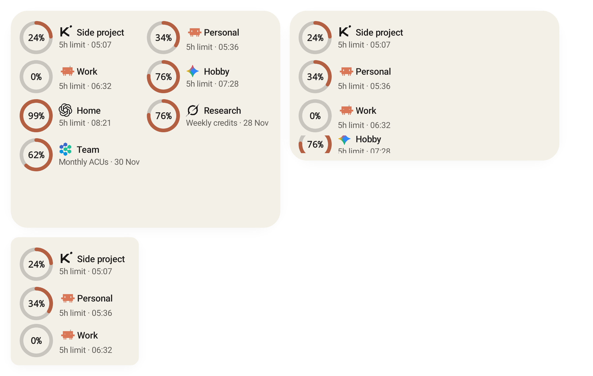
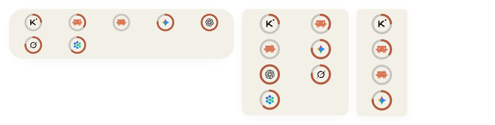
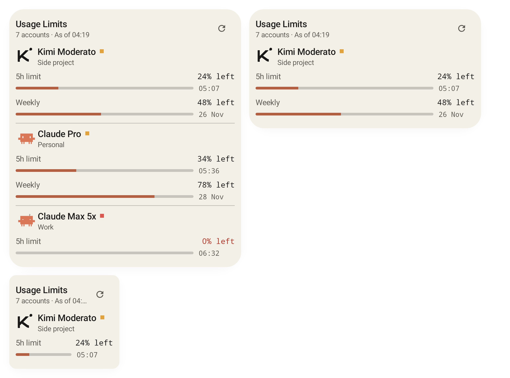
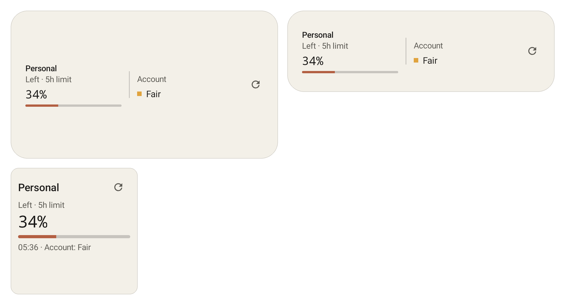
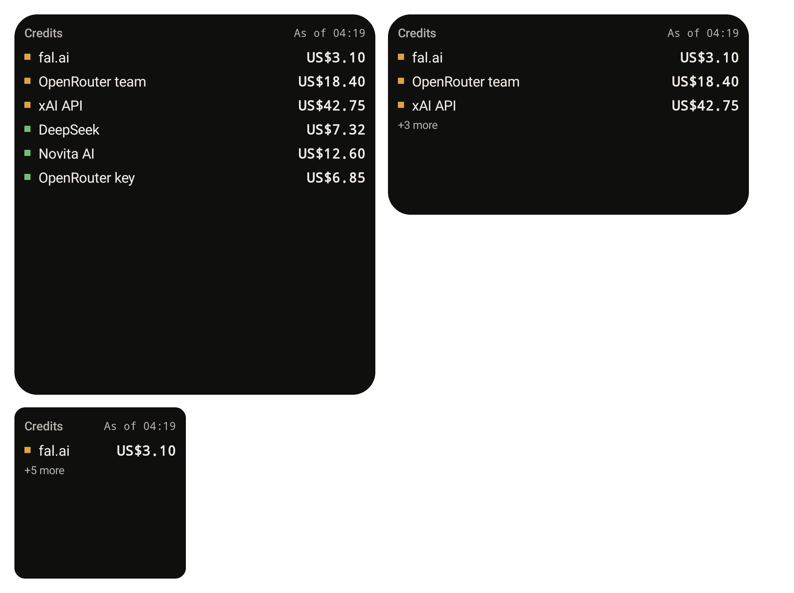
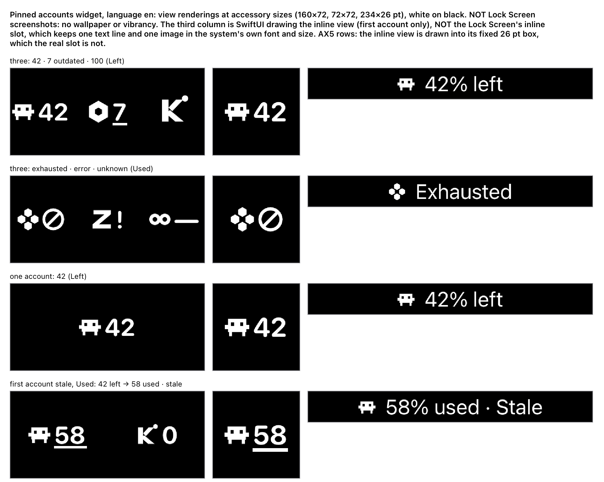

# Widgets

Widgets in [Usage Limits Mobile](../README.md) 0.5.1 show the app's cached readings. They never hold credentials or contact providers. Add accounts in the app first, then pick what to display. Phones, tablets and widget families: [Devices](DEVICES.md).

## Catalog

Real widget renders, light and dark, in every type and size.

### Account Rings

A ring per account with the provider mark, name and reset.

<picture>
  <source media="(prefers-color-scheme: dark)" srcset="images/widgets/account-rings-dark.png">
  
</picture>

### Mini Rings

Compact rings with logos; capacity depends on the size.

<picture>
  <source media="(prefers-color-scheme: dark)" srcset="images/widgets/mini-rings-dark.png">
  
</picture>

### Usage Bars

Account cards with a bar and reset time per limit.

<picture>
  <source media="(prefers-color-scheme: dark)" srcset="images/widgets/usage-bars-dark.png">
  
</picture>

### Usage Summary

One leading account with its limits and next reset (Android).

<picture>
  <source media="(prefers-color-scheme: dark)" srcset="images/widgets/usage-summary-dark.png">
  
</picture>

### Credits

Prepaid balances, worst status first: up to one, three or six accounts depending on size. Credits always uses the dark widget panel, so the light and dark boards match. The smallest Android tile has a 110 × 110 dp minimum.

<picture>
  <source media="(prefers-color-scheme: dark)" srcset="images/widgets/credits-dark.png">
  
</picture>

### iOS widgets

| Widget | iOS | Forms |
| :--- | :--- | :--- |
| Usage Bars, Account Rings, Mini Rings | 17+ | Configurable: choose an account, a service or your own selection |
| Usage Limits, Usage Limits (Clear) | 16+ | Small, medium, large and rectangular Lock Screen |
| Usage Ring | 16+ | Small and circular Lock Screen |
| Credits | 16+ | Small, medium and large |
| Pinned accounts | 16+ | Rectangular, circular and inline Lock Screen |

<picture>
  
</picture>

## Setup

**Android.** Open the launcher's widget picker, choose Usage Limits, place a widget and resize it. At placement choose Closest resets (the default), Most critical, All accounts, One account, One provider or a Custom list. Each usage widget has its own background colour, opacity and text tone, and follows the app's icon choices. Credits has no account selection.

**iOS.** Add Usage Limits from the Home Screen gallery. Configurable widgets need iOS 17; edit a custom layout's accounts and order in app Settings.

Widgets keep their own look when the app's theme or fonts change. A widget tap on an account opens its detail; a tap elsewhere opens Overview. Pin up to three usage accounts to the status bar or Lock Screen: see [Notifications](notifications.md).

## Percentages: left or used

**Settings → Display → Show percentages as** switches between **Left** (the default) and **Used** for Overview, account detail, Resets, notification texts and every usage widget; on Android the Overview chip does the same. Fills follow the displayed figure, while severity, ordering and alert thresholds always follow what is left. Credits are money and are not affected. On a German device: **Einstellungen → Anzeige → Prozente anzeigen als**, **Übrig/Verbraucht**.

## Refresh

Widgets update when the app refreshes, when you sign in, remove or reset an account, and on the system's own schedule. Background sync runs every 5, 15, 30, 60 or 180 minutes (30 by default); the system decides the exact delivery. An elapsed reset reads "Reset due" until the next fetch. The full behaviour reference is in the [architecture notes](architecture.md#widget-behaviour-reference).
